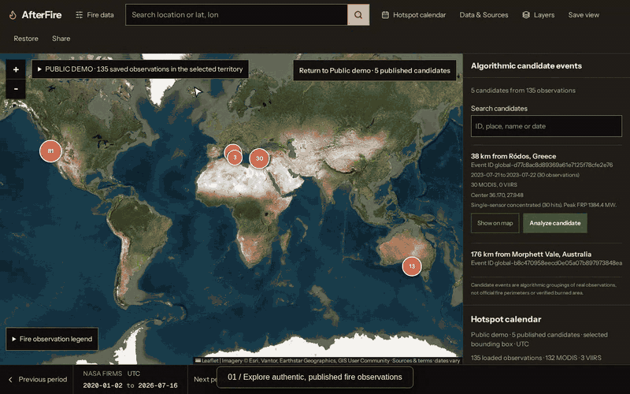
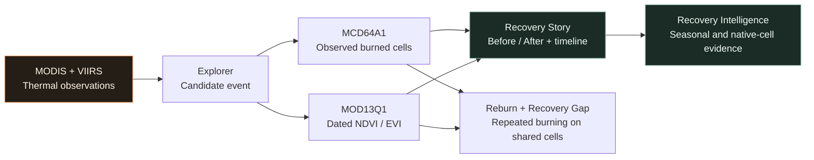
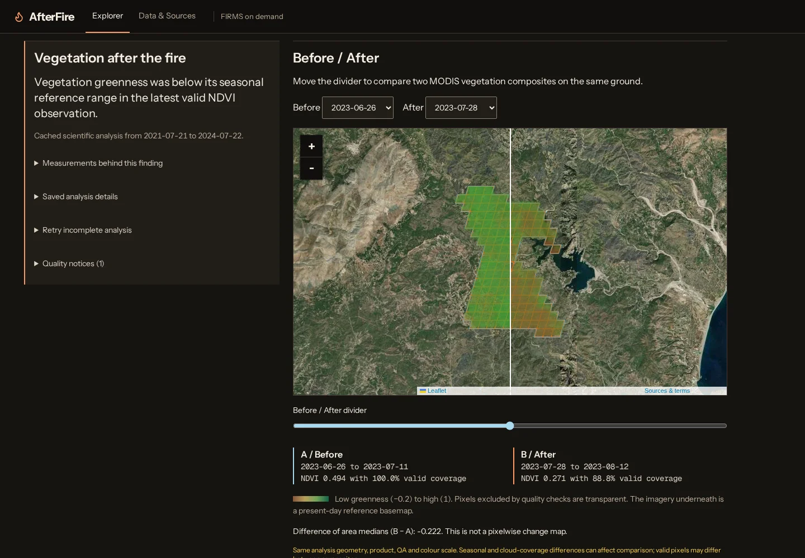
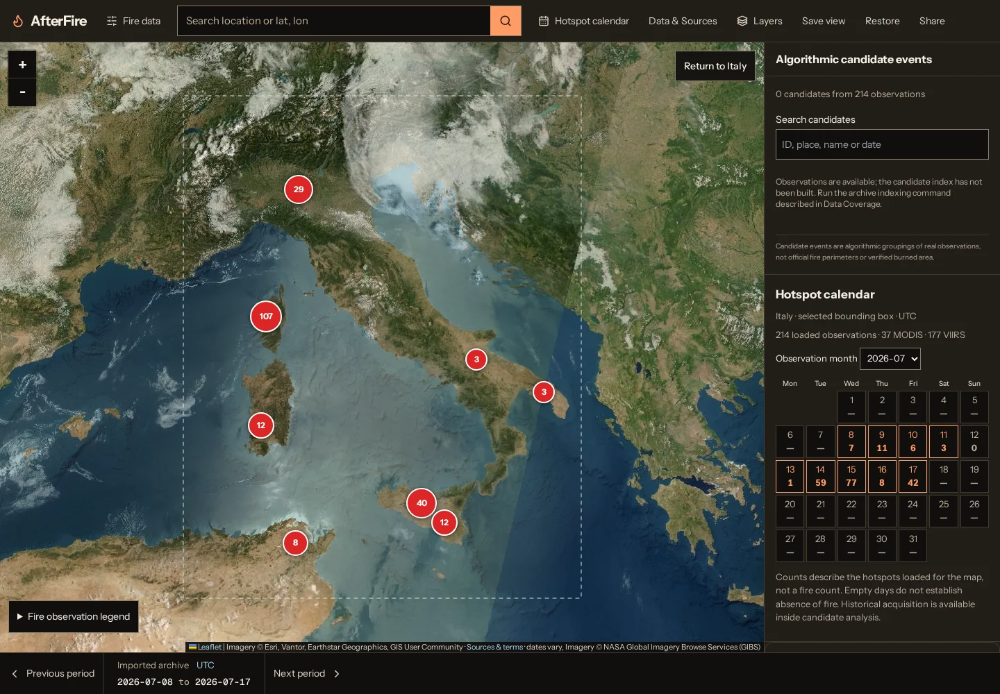
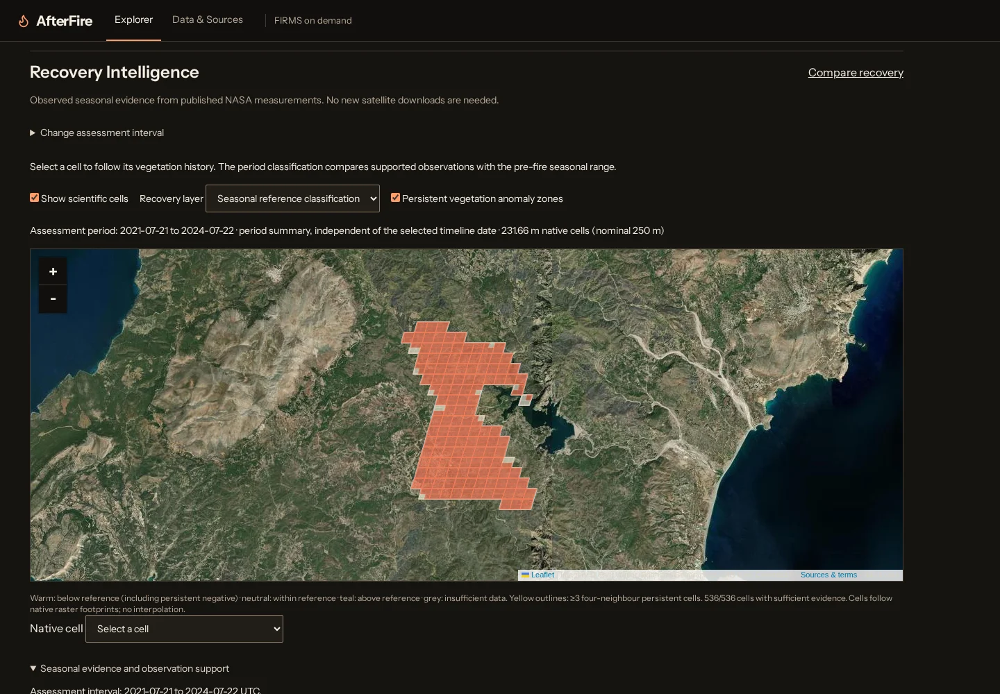
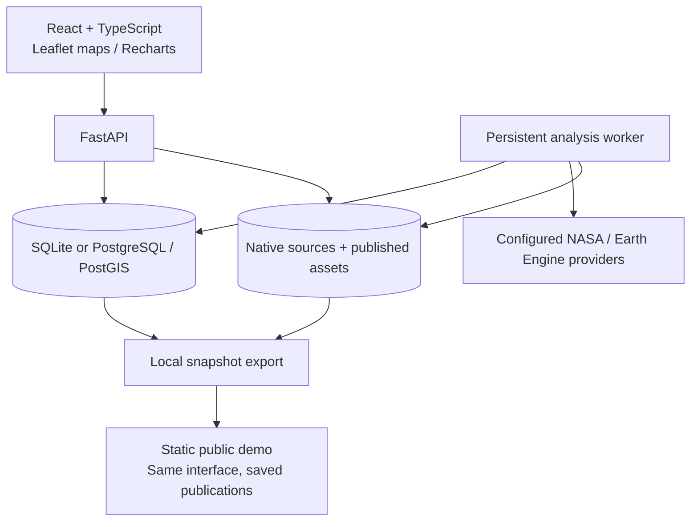

<div align="center">

# AfterFire

### The life of a forest after fire

Explore the fire. Compare the observations. Follow the vegetation.

**[Open the live demo](https://afterfire-public-demo.vercel.app)** · [Run locally](#run-locally) · [Scientific methods](docs/SCIENTIFIC_METHODOLOGY.md)

</div>

AfterFire connects NASA MODIS and VIIRS fire observations with dated satellite evidence of vegetation change. Follow an event from thermal detections to burned cells, seasonal NDVI/EVI trajectories and evidence of repeated burning on the same ground.

## See it in action

[](docs/media/afterfire-demo.mp4)

**[Watch the MP4 walkthrough](docs/media/afterfire-demo.mp4)** · Recorded from the real application with published scientific data. The [public demo](https://afterfire-public-demo.vercel.app) serves a limited, read-only snapshot; new acquisitions and analyses run in the full local application.

## From fire observations to recovery evidence



### One territory, several kinds of evidence



**Recovery Story** pairs dated composites on a shared map, with a movable divider, observation playback and NDVI/EVI charts. Seasonal references give context to the observed changes; missing and QA-rejected observations remain gaps.

| Explore the observations | Inspect recovery on the ground |
| --- | --- |
| [](docs/images/explorer.webp) | [](docs/images/recovery-intelligence.webp) |
| Filter dates and sensors, inspect original records and follow candidate events. Historical calendars distinguish acquired coverage from missing periods. | Inspect individual cells, seasonal anomalies, descriptive trends and persistent negative evidence. Reburn follows repeated mapped burns on the same native cells. |

Hotspots, candidate events and mapped burned cells have different meanings. Candidates are algorithmic groups, not official fire perimeters. Vegetation greenness does not establish complete ecological restoration, and missing observations do not establish absence of fire. Scientific overlays are dated measurements; the imagery beneath them is geographic context with independent dates. See the [methodology](docs/SCIENTIFIC_METHODOLOGY.md).

## Run locally

Run these commands from the directory containing this README and `compose.yaml`. From the parent NASA workspace, first run `cd afterfire`.

### Docker Compose

Requires Docker Engine and Compose. For the first installation:

```bash
cp .env.example .env
# Configure the providers you intend to use in .env.
docker compose up --build
```

Open the **[web application](http://localhost:3000)** or **[API documentation](http://localhost:8000/docs)**. Compose starts PostgreSQL/PostGIS, FastAPI, the analysis worker and the frontend. Database and cache volumes persist between restarts. A fresh installation needs imported or acquired observations; the screenshots are existing publications, not seed data.

### Without Docker

Requires Python 3.12, Node.js 22, npm and the backend's native raster/HDF libraries. Docker includes the packaged scientific runtime if these libraries are unavailable on your host.

```bash
python3.12 -m venv backend/.venv
backend/.venv/bin/python -m pip install -r backend/requirements.txt
npm --prefix frontend ci
cp .env.example .env
backend/.venv/bin/python scripts/local.py
```

The launcher starts API, worker and Vite with local SQLite at `backend/afterfire.db`. Logs and the scientific cache are in `.local-runtime/`; Ctrl+C stops all three processes. This database is separate from Docker's PostgreSQL volume. On Windows, use `backend/.venv-windows/Scripts/python.exe` with a virtual environment created by `py -3.12 -m venv backend/.venv-windows`.

FIRMS acquisition needs `FIRMS_MAP_KEY`. Earth Engine needs an externally registered project and credentials available to both API and worker. Configuration alone does not verify access. See [.env.example](.env.example) and [provider setup and archive import](docs/OPERATIONS.md).

## How it fits together



The full application persists jobs, source provenance and versioned results. The static demo reads explicitly exported publications through a local adapter and cannot request new science. Source code lives in `backend/`, `frontend/` and `public-demo/`; maintained commands live in `scripts/`.

## Development checks

```bash
backend/.venv/bin/python -m pytest backend/app/tests -q
npm --prefix frontend run build
python3 scripts/check_vercel_clone.py
npm --prefix public-demo run build
```

TypeScript builds reject unused locals and parameters. Backend tests use isolated temporary databases and caches. Optional PostgreSQL tests require a dedicated `AF_TEST_DATABASE_URL` whose database name starts with `afterfire_test_`.

## Read more

| Guide | What it covers |
| --- | --- |
| [Operations](docs/OPERATIONS.md) | Provider access, historical imports, persistence, API and essential commands |
| [Scientific methodology](docs/SCIENTIFIC_METHODOLOGY.md) | Native grids, QA, seasonal references, harmonization, Reburn and limits |
| [Static demo](docs/VERCEL_CLONE.md) | Export allowlist, snapshot integrity, preview and hosting |

Developed for NASA Space Apps. AfterFire is an independent project, not an official NASA service or endorsement. Code is under the [MIT License](LICENSE); NASA data, geographic references and contextual imagery retain their respective [attribution and terms](docs/SCIENTIFIC_METHODOLOGY.md#visual-comparisons-limitations-and-attribution).
