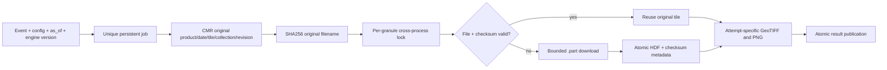

# Event analysis cache

The existing `afterfire-cache` Docker volume contains a separate `satellite/` directory. Set `AFTERFIRE_ANALYSIS_CACHE_DIR` to override the root outside Docker. The archive FIRMS files/database are never cache eviction targets.

Layout:

* `sources/{sha256}.hdf` and `.json`: immutable original granule and SHA256/size metadata.
* `locks/{sha256}.lock`: shared-event acquisition lock; no duplicate simultaneous downloads.
* `results/{job_id}/{date}-{index}-{tile}-{attempt_owner}.tif/.png`: native scientific raster and map preview.
* `integrity/`: cross-process locked, persistent file-generation/manifest verification evidence.
* `quarantine/`: retained invalid source files/sidecars; operator-managed, included in the quota.
* `quota.lock`: serializes quota checks and writes across lanes/processes.
* `usage.lock`: shared for active analyses; exclusive/nonblocking for eviction.

A cached source must have current integrity evidence before reuse. Phase 6 shares persistent SHA256/manifest/fingerprint/validator/TTL evidence across preflight, acquisition and Reburn; changed or untrusted generations require complete hashing and native validation. A corrupt file or sidecar is moved to `quarantine/` and reacquired; even invalid originals are retained rather than silently deleted. Quarantined files require deliberate operator management. Interrupted `.part` files can be removed under their granule lock during reacquisition; orphan files older than 24 hours are also eligible under the exclusive global usage lease. Atomic rename prevents incomplete files being treated as complete. Source records may refer to explicitly evicted files; disk presence and checksum, rather than DB status alone, determine reuse.

## Limits and explicit retention

| Variable | Default | Meaning |
|---|---|---|
| `AFTERFIRE_ANALYSIS_ON_DEMAND` | true | Permit enqueue API |
| `AFTERFIRE_ANALYSIS_WORKERS` | 1 | Lanes in dedicated worker service |
| `AFTERFIRE_ANALYSIS_MAX_CONCURRENT_DOWNLOADS` | 2 | Download semaphore shared by lanes |
| `AFTERFIRE_ANALYSIS_PRE_EVENT_YEARS` | 3 | Default pre-event window |
| `AFTERFIRE_ANALYSIS_MAX_POST_EVENT_YEARS` | 10 | Default upper post-event window |
| `AFTERFIRE_ANALYSIS_CACHE_MAX_GB` | 10 | Satellite source + result + temporary-file ceiling, GiB |
| `AFTERFIRE_ANALYSIS_MAX_JOB_GB` | 5 | Maximum source bytes for one job, including reused files |
| `AFTERFIRE_ANALYSIS_MAX_GRANULES` | 400 | Combined source count ceiling |
| `AFTERFIRE_ANALYSIS_MAX_AREA_KM2` | 2500 | Event analysis area ceiling |
| `AFTERFIRE_ANALYSIS_KEEP_SOURCE_GRANULES` | true | Prevent original tile eviction |
| `AFTERFIRE_ANALYSIS_CACHE_POLICY` | retain | `retain` or explicitly enabled `lru_sources` |
| `AFTERFIRE_ANALYSIS_MIN_FREE_GB` | 1 | Reserved free space, GiB |

CMR advertised volume is checked before download. Actual streaming bytes, cache usage and free disk are checked before writes; derived rasters reserve their uncompressed upper bound. A cache hit also consumes the job's source-volume budget. Whole tiles across multi-year windows may exceed the defaults: reduce years or deliberately increase limits according to disk capacity.

Automatic deletion is disabled by default. To permit LRU source cleanup set **both** `KEEP_SOURCE_GRANULES=false` and `CACHE_POLICY=lru_sources`. At the start of a new analysis it may evict the oldest sources down to 80% of the quota, but only if no active analysis holds the usage lock. It never deletes derived scientific rasters, published results, or imported FIRMS. Derived results require deliberate operator retention management; the quota fails safely instead of deleting them. Cache pressure while other jobs are active may therefore require retry after they finish.

Concurrency limits are per worker service; deploy one worker service as in Compose. File locks and quota checks still protect cache integrity across processes sharing this local volume. This cache is intended for a local POSIX filesystem, not an object-store mount. There is no API that deletes scientific results.

Completed jobs are reused for the same configuration and engine version. A changed `as_of` or configuration gets a new job, while shared original granules are reused. Failed/partial jobs can be explicitly retried with `retry=true`; simultaneous retry requests cannot reset an already active job.

See [pipeline](SATELLITE_DATA_PIPELINE.md), [methodology](SCIENTIFIC_METHODOLOGY.md), [API](POST_FIRE_RECOVERY.md).

## Phase 3 — verified pipeline and monitoring

Cache hits are SHA-256/size checked and validated as native NASA HDF before reuse. Invalid originals are quarantined; valid cache bytes never count as new network transfer. The verified event reused all 51 sources (3,890,398,220 bytes) with zero network bytes. Derived results survive container recreation. See [Phase 3 evidence](PHASE3_VALIDATION.md).

## Phase 4 durable extraction and derived windows

`satellite/subsets/<request-sha256>/manifest.json` retains the deterministic NASA task identity, exact product/layers/region/projection, files, measured byte sizes and checksums. Complete verified bundles are reusable offline. `satellite/processed/<sha256>.npz` stores QA-screened native NDVI/EVI windows, transform and source provenance with an independent checksum sidecar; the key includes source revision, analysis geometry and engine version. Complete prior windows are reused when an observation cutoff is extended. Native raster assets stay on the filesystem and database results retain metadata only. No source/result deletion or FIRMS reset is added. See [resource budgets and cache limits](SATELLITE_SUBSETTING.md).

## Integrazione Fase 5 — Recovery Intelligence

La Fase 5 estende questa implementazione preservandone osservazioni e risultati. Il preflight ora restituisce 202 con una pianificazione persistente, non un piano sincrono. Si vedano [architettura/API](RECOVERY_INTELLIGENCE.md), [metodologia degli indicatori](RECOVERY_ASSESSMENT_METHODOLOGY.md), [analisi per pixel](SPATIAL_RECOVERY_ANALYSIS.md), [preflight asincrono](ASYNC_PREFLIGHT.md), [gestione cache](CACHE_MANAGEMENT.md) e [verifica Fase 5](PHASE5_VERIFICATION.md). Le descrizioni delle prove Fase 3/4 restano evidenze storiche, non misurazioni della nuova implementazione.

## Phase 6 — Reburn & Recovery Gap

The existing implementation is extended by [Reburn Intelligence](REBURN_INTELLIGENCE.md), [observed episode methodology](REBURN_DETECTION_METHODOLOGY.md), [shared-area Recovery Gap](RECOVERY_GAP.md) and [cumulative vegetation](CUMULATIVE_VEGETATION.md). See [measured infrastructure changes](PERFORMANCE_OPTIMIZATION.md) and [verification and limitations](PHASE6_VERIFICATION.md). Previous-phase publications and reports are preserved.

## Fast analysis update — 30 October 2026

Derived map assets now share verified input-content identities across jobs using hard links. Older publications can seed the derived cache only after native-array and preview-pixel equality checks. Normal Analyze reuses persisted publications without source checks. See [Fast analysis](FAST_ANALYSIS.md).

## API-first acquisition update (2026-10-30)

Normal Analyze now prefers persisted results and verified native sources/subsets, then configured compatible Collection 6.1 APIs. Missing data never triggers automatic full-tile HDF transfer or new AppEEARS submission. Scientific QA, baselines, anomalies, recovery and reburn calculations are unchanged. ORNL collection equivalence and live Earth Engine access remain explicit limitations. See [API-first engine](API_FIRST_SATELLITE_ENGINE.md), [provider equivalence](PROVIDER_EQUIVALENCE.md) and [verification](API_FIRST_VERIFICATION.md) for current behavior; older acquisition descriptions above are historical.
