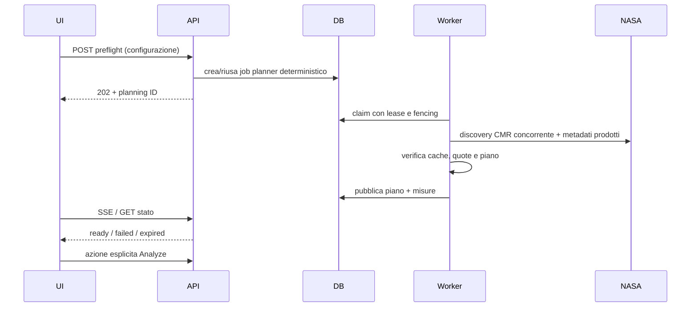

# Preflight asincrono persistente

Il precedente `POST /events/{id}/analysis/preflight` eseguiva discovery CMR e verifica cache in una richiesta sincrona; la Fase 4 documentava una chiusura client oltre 120 s (499 del proxy). La Fase 5 restituisce **202 con ID persistente**, mantenendo l’elaborazione nella coda database esistente. [Misure reali](PHASE5_VERIFICATION.md), [cache](CACHE_MANAGEMENT.md).

Stati esposti: queued, discovering, checking_cache, ready, failed, expired. La coda usa internamente fetching/processing/completed e gli stessi lease di tre minuti, heartbeat e fencing delle analisi. Non vengono duplicati sistemi di coda o avviati download scientifici/task AppEEARS dal planner. I job planner sono esclusi dalla selezione dell’ultima analisi scientifica.

Identità SHA-256 di evento, osservazioni FIRMS associate ordinate (date/coordinate), configurazione/AOI, prodotti/bande, regole scientifiche, versione planner e abilitazione AppEEARS. La primary key deduplica anche richieste concorrenti. Un piano completo resta valido per 6 ore configurabili; retry dei fallimenti e riaccodamento dei piani scaduti sono condizionali. Un lease abbandonato viene recuperato dalla stessa coda. L’ID è conservato in sessionStorage per riprendere lo stato dopo reload; il lavoro continua anche senza browser.

Endpoint sotto `/api/v1`:

- `POST /events/{event_id}/analysis/preflight` → 202, nessun piano sincrono;
- `GET /events/{event_id}/analysis/preflight/{planning_id}`;
- `GET /events/{event_id}/analysis/preflight/{planning_id}/stream` → SSE, keepalive;
- l’avvio esplicito dell’analisi conserva `POST /events/{event_id}/analysis`.

**Cambio di contratto:** i vecchi client devono leggere `plan` solo quando lo stato è ready. Non devono aspettare il piano nel corpo della POST. La UI è stata aggiornata, con polling come fallback alle interruzioni SSE. Un timeout NASA produce failed con retry, non un insieme vuoto di dati. I risultati scientifici precedenti restano disponibili.

## Metadati e misure

Cache `satellite/catalog`, distinta da sorgenti, subset e risultati. Chiavi deterministiche includono prodotto/versione, bbox, periodo, limite e versione parser. TTL predefinito 24 ore, ridotto a un’ora per discovery che termina negli ultimi 60 giorni. I successi vuoti sono memorizzati; errori provider non vengono registrati come vuoto. Lock cross-process non bloccanti per deduplicare richieste simultanee, scrittura atomica, timestamp di acquisizione e provenienza. Nessun uso indefinito di cataloghi scaduti.

Le due ricerche del preflight sono concorrenti. I metadati AppEEARS vengono interrogati attraverso endpoint pubblici e validati contro i layer obbligatori; il planner non effettua login né POST task. Le singole richieste CMR usano connect timeout 10 s e read timeout 30 s. Un fallimento non innesca una raffica di retry: il retry esplicito riusa i metadati validi e la stessa identità job.

Sono misurati HTTP CMR, enumerazione/validazione granuli, cache metadati/attesa lock, HTTP AppEEARS, validazione prodotti, verifica sorgenti/costruzione piano e totale. I tempi HTTP concorrenti sommati possono superare il tempo di parete. Il blocco cache/piano include stime e verifiche del filesystem: non viene spacciato per latenza NASA.

La verifica di un originale HDF può essere riutilizzata solo con stesso dispositivo, inode, dimensione, mtime e ctime, stesso checksum/identità e stessa versione del validatore, entro il TTL. Una modifica o scadenza forza checksum e validazione scientifica completi. Il piano viene comunque ricontrollato dal worker prima dell’acquisizione per quote, disponibilità e spazio libero. Non si aumenta il timeout del proxy per mascherare il problema.

La pipeline di acquisizione riutilizza direttamente la sorgente appena verificata sotto il lease condiviso: non rientra nel downloader per ricalcolare inutilmente lo stesso checksum. La validazione scientifica di bande/griglia resta applicata. Il test integrato verifica le stesse statistiche sia da sorgenti nuove controllate sia da cache, con zero byte nuovi nel secondo caso.

## Phase 6 — Reburn & Recovery Gap

The existing implementation is extended by [Reburn Intelligence](REBURN_INTELLIGENCE.md), [observed episode methodology](REBURN_DETECTION_METHODOLOGY.md), [shared-area Recovery Gap](RECOVERY_GAP.md) and [cumulative vegetation](CUMULATIVE_VEGETATION.md). See [measured infrastructure changes](PERFORMANCE_OPTIMIZATION.md) and [verification and limitations](PHASE6_VERIFICATION.md). Previous-phase publications and reports are preserved.

## Fast analysis update — 30 October 2026

Preview is optional and never gates opening a saved result or requesting a queued analysis. Its identity includes submission policy. It does not submit tasks or acquire scientific data. See [policy](APPEEARS_SUBMISSION_POLICY.md).
