# Final functional verification — 6 November 2026

AfterFire's event workflow can analyze and display post-fire vegetation evidence; it is more than a hotspot map. The audit repaired entry points, removed misleading fixed metrics and completed native-cell history inspection. It does **not** certify 100% original-vision acceptance: a supported positive vegetation Recovery Gap, controlled reboot/worker interruption and exhaustive accessibility/geographic coverage remain unverified.

## A. Original vision coverage

The [requirements matrix](ORIGINAL_REQUIREMENTS_AUDIT.md) reconstructs the initial README at `3877cd7` and the subsequent Phase 2–7 contracts. The original mean-based recovery quotient was superseded by the documented seasonal event methodology. The audit found that Home, navigation and Compare still exposed the old assumptions alongside the new engine. These connections are corrected without replacing the architecture or duplicating scientific calculators.

Changes:

- Home's fixed synthetic impact/recovery values are replaced with bounded real FIRMS observation-window links for Rhodes, Jasper and Kangaroo Island.
- `/recovery` lists actual persisted event assessments, with loading/error/empty states. Navigation opens this library instead of a hardcoded legacy area.
- `/compare` presents the existing 2–4-event seasonal-anomaly/common-horizon comparison only, including sustained return and support. Event-link preselection is now applied once so deselecting the initial event remains possible. The old non-seasonal quotient panel is removed from this page.
- Recovery Intelligence cell selection opens the existing dedicated API's full native-cell chart and dated table: observed value, pixel reference, anomaly, reference count/years, missing values, grid identity, approximate footprint centre and provenance. No event mean is substituted for cell evidence.
- Persistence-map colours distinguish below/within/above reference and insufficient support. Period classification remains distinct from a selected-date anomaly.
- Story includes accessible explanations of NDVI/EVI, baseline, anomaly, null observations and ecological limits. Legacy area reports identify their different methodology and link to current event stories.

## B. Post-fire territory recovery

[Independent validation](POST_FIRE_RECOVERY_VALIDATION.md) covers strict QA, raw scaling, native grid, mapped burn dates/area, seasonal median/MAD, anomaly, monthly descriptive trend, persistence, sustained return and per-cell references. The existing scientific thresholds and NASA observations were retained.

Initial impact, current supported anomaly, trend, sustained reference return, historical persistent negative periods, observation support and spatial heterogeneity remain separate interpretable indicators. There is no new recovery score, probability or ecological restoration claim. NDVI/EVI use their own masks and local references. Before/After compares dated spatial medians on one synchronized map; it is not a common-pixel causal change estimate. The contemporary basemap is geographic context, not a historical photograph.

Reburn uses native shared ground cells and uncertainty intervals; Recovery Gap requires pre-second-episode evidence on that shared ground with the pre-first-fire reference. The original verified Rhodes history has zero repeat cells and insufficient evidence. A separate fixed Chips/Dixie raw-source probe found 710 shared native burned cells in 2012/2021. The subsequent real candidate/worker publication independently confirms 228 repeat cells / 48.9422 km² on its own smaller event-associated area. Recovery Gap remains insufficient because the unchanged 400-granule bound prevented the long vegetation acquisition. Positive controlled tests remain separate from both real-source checks.

## C. Real scientific cases

Current publications were read before expectations were recorded: Rhodes 64 valid observations per index / 134 burned cells / 28.7643 km²; Jasper 6 per index / 32 cells / 6.8691 km²; Kangaroo Island 56 per index / 112 cells / 24.0418 km². These are local candidates, not full disaster extents. All three are partial publications. Rhodes/Kangaroo anomalies remain negative despite increasing descriptive trends. Jasper's new persisted assessment correctly reports insufficient seasonal evidence. See the scientific report for dates, trend units, support and gaps.

Additional real Chips/Dixie testing selected 178 FIRMS detections, mapped 230 event cells and published 228 repeated cells in a 133-month history; four components are not four official fires. The positive history is independently checked, with missing vegetation evidence retained.

New reference FIRMS tests use bounded Area API windows: Italy 21 detections/2 candidates; Rhodes 30/1; Jasper 11/1; Kangaroo Island 13/1. Ocean, high-latitude and dateline checks returned empty available responses, which do not prove fire absence. Unsupported 1990 MODIS dates are rejected. New live Earth Engine probes succeeded separately in API and worker with integer raw/QA bands. No full HDF transfer or new AppEEARS submission occurred.

## D. Frontend and user experience

[Desktop/mobile verification](RECOVERY_UX_VERIFICATION.md) records actual Chromium checks at 1440×1050 and 390×844, selected events, Story, lazy assets, EVI, split-date comparison, Intelligence, cell histories, cross-event comparison, Reburn navigation and reload. DOM assertions, API-to-table agreement, runtime errors and horizontal overflow are checked. Screenshots were inspected separately; the record identifies the exact deployed build and limitations.

## E. Engineering, security and performance

A live-configured candidate without linked FIRMS observations previously reached geometry creation and produced HTTP 500. It now returns explicit HTTP 422 before a job is created; a new regression verifies the result. A real historical boundary trial also exposed tile acquisition triggered by round-trip coordinate noise where a whole-cell union merely touches the neighbouring tile. Tile bounds now use half-open enumeration and snap only within 1e-10 tile (about 0.1 mm) of an integer boundary. Two regressions distinguish a boundary touch from a real cross-tile footprint. This changes source enumeration, not pixel values, QA or scientific thresholds. Tests explicitly clear inherited Earth Engine/Earthdata/LLM credentials; provider tests opt in with controlled mocks. This prevents production environment settings from changing isolated test semantics or contacting live providers accidentally.

**192 SQLite tests pass; 192 PostgreSQL/PostGIS tests pass.** The new PostgreSQL database is `afterfire_test_audit_20261106`, separate from scientific state. An initial test-copy collection failure was caused by omitted import scripts; a subsequent run exposed inherited live configuration. Both setup problems were corrected and the complete suite rerun without disabled tests. Existing SQLAlchemy/affine/date deprecation warnings remain; passing tests do not imply those warnings are resolved.

TypeScript, Vite production builds and Docker builds pass. `npm audit` initially reported 1 high and 3 moderate package entries. Vite 5 → **6.4.5** and Router 6 → **7.18.5** resolve the known entries; the final audit reports **zero**. Vite 6 is the nearest patched major compatible with the existing React plugin; Router's open-redirect fix requires 7.18+. React 18 is retained; no framework/SSR migration or forced audit fix was used. Docker already uses Node 20; documentation now requires Node ≥20. Recharts 2 prints an upstream deprecation notice but has no reported npm security advisory in this audit.

Primary upgrade references: [Vite 5→6 migration](https://v6.vite.dev/guide/migration), [Router migration](https://reactrouter.com/7.18.5/upgrading/v6), [Router redirect advisory](https://github.com/advisories/GHSA-wrjc-x8rr-h8h6), [esbuild advisory](https://github.com/advisories/GHSA-67mh-4wv8-2f99), [Vite launch-editor advisory](https://github.com/advisories/GHSA-587h-7wmj-h5pm).

Deployment retains PostGIS, API, separate worker, persistent named volumes, read-only ADC mounts, ordered health checks, `unless-stopped` and loopback ports. Cache/source fingerprints, publication identities, fenced leases, heartbeat, duplicate-job handling, SSE and transaction behavior are covered by source review and regressions. Service recreation and API payload fingerprints are recorded in the machine evidence. No active scientific job was deliberately interrupted; no reboot or destructive prune was initiated by the agent. A subsequent external host restart was observed and original result/assessment/Reburn fingerprints remained identical after automatic service recovery.

Global request throttling is per-process; provider requests, viewport, pixel, source, area, storage, concurrency and operation duration are bounded. Admin cache inspection requires a bearer token. Scientific job submission and the general read API remain a trusted loopback application, not an authenticated public multi-user service. Nginx has its request-size default; direct loopback Uvicorn has no general body-size middleware. No distributed rate limiter, public account system or unrestricted-internet security certification is claimed.

Performance measurements distinguish cached API reads/browser rendering from new pipeline work. No new controlled cold/warm A/B optimization trial was performed; the earlier 22.702 s/2.306 s timings remain historical. This release does not claim an acquisition-speed improvement. Current snapshots: database 32 MB; satellite cache 16 MB; two Docker volumes 374.9 MB; images 2.696 GB; build cache 2.51 GB (post-restart snapshot; earlier disk sample had 90 GB available). These are not unique image sizes or peak memory. Publications/cache were preserved; no cache purge or scientific value change was needed.

## F. GitHub delivery

Initial source `5d117cd`; original requested reference `a600eb1` was already superseded. `main` was synchronized with origin before intervention. Scanned, normal-pushed checkpoint **`b152975`** protects the tracked starting state. Pre-existing untracked historical JSON/screenshots were preserved and never staged indiscriminately.

Final delivery uses logical commit(s), staged and all-tracked `scripts/check_secrets.py` scans, fresh fetch/divergence check and normal fast-forward push only. The actual final remote SHA is verified with `git ls-remote` and reported in the delivery message. `.env`, ADC, credentials, databases and scientific cache remain outside Git. No force push or history rewrite is authorized or used.

## Remaining acceptance limits

- The positive Chips/Dixie history is verified end to end; its vegetation Recovery Gap remains insufficient and 66/133 months have incomplete spatial mapping.
- No agent-initiated controlled reboot, real mid-job interruption or power-loss experiment. An external host restart and unchanged original result hashes were observed.
- Browser coverage samples representative interactions; no exhaustive WCAG, every browser/device, every geography or provider-availability guarantee.
- All three reference analyses and the additional Chips publication remain partial; remote-sensing indices alone do not establish ecological recovery.
- Legacy area endpoints retain their historical method and are explicitly separated from the supported event workflow.
- The deployment is trusted and loopback-bound; public multi-user authentication/distributed abuse prevention would need additional work.

These limits are retained in the [release checklist](FINAL_RELEASE_CHECKLIST.md), rather than declared complete because regressions pass.

```mermaid
flowchart LR
  Home[Home or Recovery library] --> Explorer[Bounded FIRMS Explorer]
  Explorer --> Select[Select real candidate]
  Select --> Availability[Satellite availability and preflight]
  Availability --> Queue[Durable fenced worker job]
  Queue --> EE[Bounded native EE arrays and QA]
  EE --> Burn[Mapped burned territory]
  Burn --> Reference[Seasonal reference and observations]
  Reference --> Publication[Atomic DB publication and protected native assets]
  Publication --> Story[Recovery Story and synchronized dates]
  Story --> Intelligence[Cell histories and supported spatial patterns]
  Intelligence --> Compare[Locally referenced common-horizon comparison]
  Publication --> Reburn[Mapped episodes and shared-cell Recovery Gap]
  Publication --> Cache[Persisted result and asset reuse]
  Cache --> Story
```

### Delivery approval block

The automatic approval reviewer rejected the final combined commit/push action because it did not recognize trusted authorization for publishing this broad release to shared `main`. No bypass, indirect push or force push was attempted. The tested release is retained on local review branch `audit/recovery-final-20261106`; the remote pre-audit checkpoint remains `b152975`. Staged/tracked secret scans passed. A direct user confirmation is requested before shared-branch publication; the final push/remote-SHA acceptance item remains incomplete.
