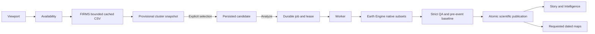

# Global on-demand architecture

The clean-install workflow starts in Explorer, centered on Italy. The browser requests only its actual debounced viewport, at most 30° per dimension and 1–7 UTC days. Dateline viewports split into two bounded requests. NASA availability determines MODIS/VIIRS SP/NRT source/date segments; missing satellite dates are explicitly reported in `coverage.complete` and `coverage.missing_coverage`. Provider failures and unsupported periods are never empty-fire responses.

CSV caching is shared across processes; requests are serialized, capped and deduplicated. Snapshots are bounded/disposable, while selected candidate detections and scientific publications persist. Clusters are reproducible for their exact viewport, dates and observations; changing boundaries may change membership and candidate IDs. Thermal points, provisional geometry and observed burned cells have separate meanings. There is no worldwide archive import, silent HDF fallback or new AppEEARS task.

See [release verification](FINAL_RELEASE_VERIFICATION.md) for real multi-continent checks, performance, limits and reproduction commands; [scientific methodology](SCIENTIFIC_METHODOLOGY.md) for baseline/QA; [cache policy](CACHE_MANAGEMENT.md) for protected results and explicit cleanup.

## Final functional audit — 6 November 2026

The [requirements matrix](ORIGINAL_REQUIREMENTS_AUDIT.md), [independent current-data validation](POST_FIRE_RECOVERY_VALIDATION.md), [desktop/mobile checks](RECOVERY_UX_VERIFICATION.md) and [final report](FINAL_FUNCTIONAL_VERIFICATION.md) supersede earlier release-status claims. Scientific thresholds, source observations and previously published results remain unchanged. The current entry point is Explorer or `/recovery`, listing persisted event assessments. Cell selection now opens its native NDVI/EVI history, seasonal reference, anomalies and explicit missing dates. Compare uses seasonal event anomalies on the common observed post-fire horizon; legacy non-seasonal area quotient panels are excluded.
