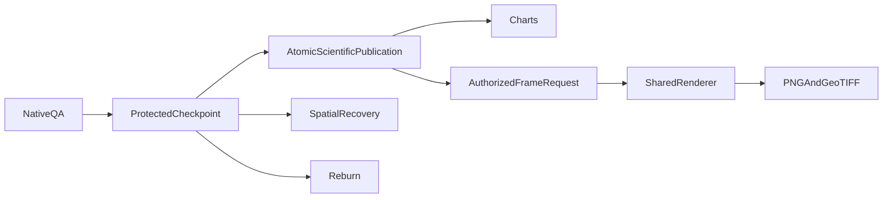

# Native science first, visualization on demand

[Performance report](ULTRA_FAST_ANALYSIS.md) · [Recovery Story](RECOVERY_STORY.md)

A scientific observation publishes its QA-screened native NDVI/EVI checkpoint,
protected by hard links inside the immutable result folder. The manifest records
its checksum, index, rendering/QA version, bounds and asset names. The checkpoint
contains the source provenance, native transform and observation arrays; its source
identity includes event geometry and scientific engine version. Result cleanup
protects these files and reference auditing includes the native manifests.

The atomic scientific publication exposes explicit summary/native-spatial `ready`
and visual `on_demand` states. These mean all available observations have been
processed; nulls and partial scientific support retain their prior meaning.
No PNG or derived GeoTIFF is required to display charts.

The existing asset route checks ownership against the published result, verifies
the protected native checksum and renders the requested frame in a bounded IO
thread. The existing content/transform/render-version key, file lock, integrity
manifest and hard links share identical raster work across simultaneous requests.
Incomplete files use atomic rename. Old published assets remain accessible.

Recovery Intelligence and Reburn read the protected arrays directly. The adapter
casts to the original scientific GeoTIFF float32 domain, preserving exact spatial
values rather than silently increasing numerical precision. Temporal statistics
retain their original floating point computation. Neither reader needs PNGs.

The existing timeline requests the chosen frame, prefetches one neighbour, clears
obsolete browser image requests and pauses playback until the frame loads. Charts
remain independent. Before/After still requires both supported observations.

