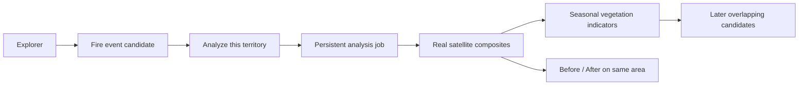
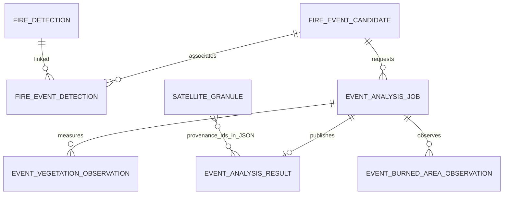

# Event-scoped post-fire recovery

The existing Explorer and FIRMS archive feed a dedicated event analysis. No satellite acquisition occurs on page load. Choose a real candidate, open its stable `/events/{id}` URL and press **Analyze this territory**. Pre/post years and provisional buffer can be changed before requesting. A published partial result remains available during retry.



The map uses shared Esri World Imagery (variable/unknown acquisition date), dated FIRMS observations, the analysis geometry, associated MCD64A1 cells and QA-masked MOD13Q1 rasters. No generic satellite photograph stands in for an index measurement. Burned cells remain an event-period overlay, explicitly separate from the selected vegetation composite. Raster previews use nearest-neighbour reprojection and a fixed −0.2 to 1 colour scale. Native sinusoidal scientific GeoTIFFs are downloadable. Missing pixels are transparent.

The observation selector, discrete slider and chart share one date. At a date with no vegetation composite, the map does not substitute another date. Before/after selects only valid, wholly pre-event and post-event composites from the same result geometry/product/QA. Different valid-pixel coverage and seasonality are disclosed.

## API

All paths start with `/api/v1/events/{event_id}`:

| Method | Path | Meaning |
|---|---|---|
| POST | `/analysis` | Idempotent enqueue or reuse; HTTP 202 even when already completed |
| GET | `/analysis/status` | Durable phase, files, transfer/cache bytes, timings, engine/configuration and result_job_id |
| GET | `/analysis/stream?job_id=...` | SSE telemetry, automatic reconnect and polling fallback |
| GET | `/analysis/result` | Complete published result, including explicit missing composites |
| GET | `/vegetation/timeseries?index=NDVI` | NDVI or EVI event-scoped series |
| GET | `/burned-area` | Observed cells and association/quality summary |
| GET | `/recurrence` | Later overlapping candidates, gap and recent vegetation evidence |
| GET | `/analysis/metadata` | Sources, checksums, configuration, warnings and provenance |
| GET | `/analysis/assets/{job_id}/{filename}` | Published QA-masked PNG or native scientific GeoTIFF |

GET endpoints optionally accept `job_id` to retrieve a particular configuration. IDs are checked against the event; assets must belong to its published result. Unknown events return 404; invalid configuration returns 422; disabled on-demand mode returns 503. HTTP requests enqueue only; downloads never run in an API request.

```json
{"configuration":{"pre_years":3,"post_years":10,"buffer_m":1000,"burn_tolerance_days":3,"seasonal_window_days":24,"min_baseline_years":2,"min_valid_fraction":0.5,"as_of":"2026-10-28"},"retry":false}
```

`as_of` defaults to the request date and cannot exceed today or precede the event end. `post_years` is an upper bound, not an assumption of data availability. CMR holdings determine actual coverage. Events without associated observations fail explicitly. Synthetic candidates cannot request real acquisition.

## Persistence

`satellite_granules`, `event_analysis_jobs`, `event_analysis_results`, `event_vegetation_observations` and `event_burned_area_observations` are additive tables. Existing area-scoped vegetation/recovery routes remain available, but the event page now uses only the event-scoped engine. No reimport or deletion of FIRMS is performed.



GeoJSON geometries are WGS84 and compatible with PostGIS, for example `ST_SetSRID(ST_GeomFromGeoJSON(analysis_geometry::text),4326)` in `event_analysis_results`. Numerical extraction and cell area calculations use the native equal-area MODIS sinusoidal CRS. Raster files live on the persistent cache volume, never as database blobs.

Read [pipeline](SATELLITE_DATA_PIPELINE.md), [methodology](SCIENTIFIC_METHODOLOGY.md), [cache](ANALYSIS_CACHE.md), [verification](POST_FIRE_VERIFICATION.md) and [backend setup](../backend/README.md).

## Phase 3 validation

The 2.1.0 engine validates HDF identity/grid/calibration before processing. The worker persists structured telemetry in `event_analysis_progress`; all maps use the shared satellite basemap. Previous publications remain accessible when a newer job fails. See [real numerical, API and browser evidence](PHASE3_VALIDATION.md).

## Phase 4 extension

The same event endpoint, worker queue, scientific masks and result publication now support cache-aware preflight, native AppEEARS subsets, annual task persistence and reusable processed vegetation windows. The configured observation interval is preserved. The event page integrates the real-composite Recovery Story and one-map temporal comparison. See [Recovery Story](RECOVERY_STORY.md) and [verification](PHASE4_VERIFICATION.md).


## Integrazione Fase 5 — Recovery Intelligence

La Fase 5 estende questa implementazione preservandone osservazioni e risultati. Il preflight ora restituisce 202 con una pianificazione persistente, non un piano sincrono. Si vedano [architettura/API](RECOVERY_INTELLIGENCE.md), [metodologia degli indicatori](RECOVERY_ASSESSMENT_METHODOLOGY.md), [analisi per pixel](SPATIAL_RECOVERY_ANALYSIS.md), [preflight asincrono](ASYNC_PREFLIGHT.md), [gestione cache](CACHE_MANAGEMENT.md) e [verifica Fase 5](PHASE5_VERIFICATION.md). Le descrizioni delle prove Fase 3/4 restano evidenze storiche, non misurazioni della nuova implementazione.


## Phase 6 — Reburn & Recovery Gap

The existing implementation is extended by [Reburn Intelligence](REBURN_INTELLIGENCE.md), [observed episode methodology](REBURN_DETECTION_METHODOLOGY.md), [shared-area Recovery Gap](RECOVERY_GAP.md) and [cumulative vegetation](CUMULATIVE_VEGETATION.md). See [measured infrastructure changes](PERFORMANCE_OPTIMIZATION.md) and [verification and limitations](PHASE6_VERIFICATION.md). Previous-phase publications and reports are preserved.


## Fast analysis update — 30 October 2026

Saved partial publications remain valid scientific publications with quality notices. Normal Analyze reuses them; updating missing observations is explicit. See [Fast analysis](FAST_ANALYSIS.md).
