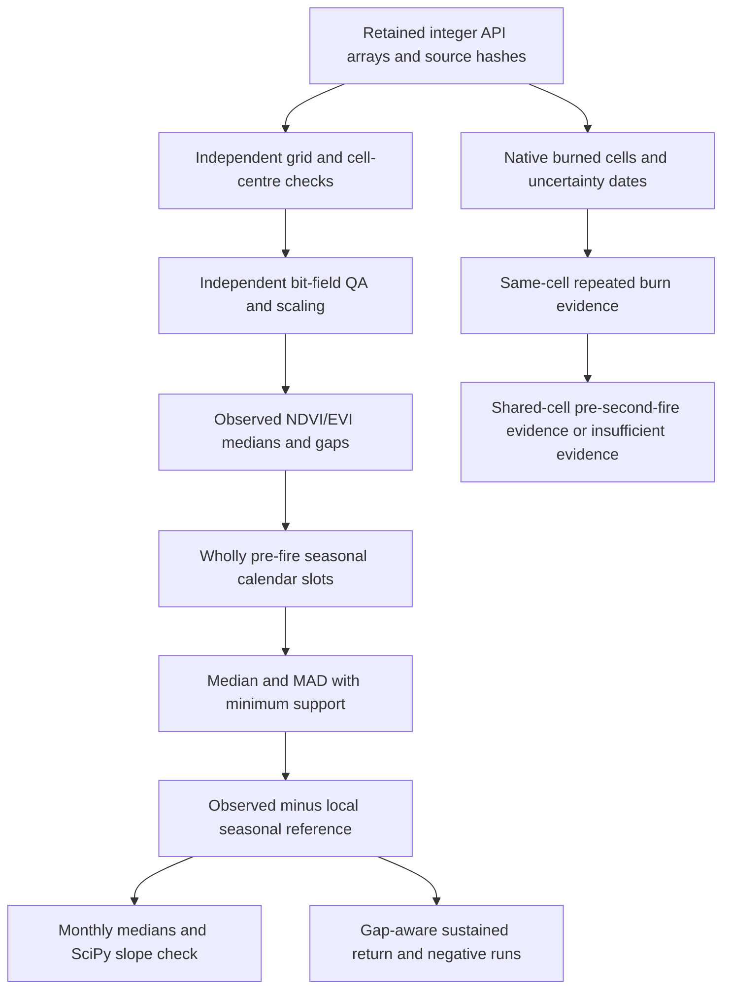

# Post-fire recovery validation — 6 November 2026

This is a new read-only numerical verification of the current persisted NASA publications and retained bounded Earth Engine source arrays. It is not a repeat of historical HDF equivalence. Deleted HDFs were not downloaded. No AppEEARS task, global archive or synthetic fire was created.

Reproduce inside the configured backend: `PYTHONPATH=/app python /path/to/scripts/verify_recovery_independent.py`. The script imports database/cache access only; it does not call the production QA, baseline, trend, episode or persistence calculators. Evidence: [machine-readable final record](final-recovery-evidence-2026-11-06.json).

## Sources and independent checks

Raw GeoTIFF checksums and Collection 6.1 identity are checked first. Source arrays retain integer NDVI/EVI, DetailedQA, SummaryQA, BurnDate, Uncertainty, QA, FirstDay and LastDay. Pixel-centre geometry masks are applied on the native sinusoidal grid, without reprojection of scientific values. QA fields are decoded independently using binary strings; accepted raw integers are divided by 10,000, and spatial medians/counts are compared to published composites. Native spacing and whole-cell areas are derived from the sinusoidal sphere circumference (`R=6371007.181`), rather than the engine's tile constants.

All 278 burned cells in the original three reference publications are checked against the raw source pixel: date, uncertainty, land/valid flags, non-shortened mapping, event-window overlap and actual equal-area footprint. These are candidate-associated satellite cells, not official perimeters or complete disaster areas. The FIRMS provisional buffer never becomes mapped burned area; missing evidence stays unknown.

Seasonal references are independently selected by enumerating calendar slots around the target in leap year 2000. Only complete pre-fire composites enter the reference, and pre-fire chart targets use earlier composites only. At least three references and two years are required. Median, MAD, lower/upper band and anomaly are recomputed. The exact current configuration remains authoritative; no threshold was changed.

Trend is independently compared with SciPy `theilslopes` on monthly median anomaly/day samples, using actual elapsed days and 365.2425 days/year. Persistence and sustained return are rebuilt by grouping supported dated runs, including explicit breaks at missing/QA-rejected composites and excessive gaps. Native-cell baselines and anomalies are checked separately from the event medians. Null values do not become zero.

## Current real cases

| Candidate observation window | Valid NDVI / EVI | Baseline entries per index (all phases) | Native burned cells | Observed area |
|---|---:|---:|---:|---:|
| Rhodes, 20–22 July 2023 | 64 / 64 | 41 | 134 | 28.7643 km² |
| Jasper, 23–25 July 2024 | 6 / 6 | 0 | 32 | 6.8691 km² |
| Kangaroo Island, 2–4 January 2020 | 56 / 56 | 40 | 112 | 24.0418 km² |

These values were read from current publications before use, not inserted as expected values. Across the three cases, 408 index/composite records, 151,232 raw QA pixel evaluations and 278 burned cells were checked. The two supported assessments contain 536 and 448 native vegetation cells; every cell's available seasonal reference/anomaly history was independently checked. Counts are evaluations, not unique globally independent observations.

| Candidate | Latest supported NDVI anomaly | Latest supported EVI anomaly | NDVI / EVI descriptive trend per year | Post-fire baseline support |
|---|---:|---:|---:|---:|
| Rhodes | −0.20165 (25 June 2024) | −0.11195 (25 June 2024) | +0.03018 / +0.05151 | 21/23 expected composites each |
| Jasper | unavailable | unavailable | unavailable | 0/23 each; 2 valid post-fire observations each |
| Kangaroo Island | −0.34175 (18 December 2020) | −0.151975 (18 December 2020) | +0.14659 / +0.12784 | 17/23 expected composites each |

Rhodes and Kangaroo Island remain `below_reference`, with increasing descriptive anomalies. Positive slopes do not establish significance, causation or complete ecological restoration. Jasper has four valid pre-fire and two valid post-fire observations per index, insufficient seasonal references and `insufficient_data` for both indices. A new cached-source assessment was published for Jasper during this audit, without changing its observations.

All three science publications are **partial**. The assessment support labels describe the observed interval, not completeness of every source or every expected date. A missing final slot means the last supported observation can precede the configured cutoff. Historical negative periods may exist even when no currently persistent connected zone meets all criteria. The current Rhodes/Kangaroo maps contain zero current qualifying zones; no thresholds were relaxed to produce positive zones.

## Reburn and Recovery Gap

The current Rhodes 2021–2024 history has two mapped spatiotemporal components, zero repeated native ground cells and `insufficient_evidence`. Independent reconstruction checks all 37 retained MCD64 source references against the published cell/date observations. Two components on different ground do not establish two repeat fires. No positive real Recovery Gap is supported in this case. Controlled positive/negative reburn and shared-cell tests remain explicitly synthetic tests.

A separate bounded source reconnaissance was performed for the Chips (2012)/Dixie (2021) region identified in [Jasperse et al. (2025), primary field research](https://doi.org/10.1186/s42408-025-00378-z), with [NASA's Chips fire account](https://science.nasa.gov/earth/earth-observatory/chips-fire-burn-scar-79105/) as historical context. A fixed rectangle `[-121.30,40.00,-121.10,40.15]` was declared before acquisition and not adjusted. Four MCD64A1.061 monthly windows (August/September 2012 and July/August 2021) used 270,560 decoded raw bytes and eight explicit operations. Strict native land/valid/non-shortened QA and uncertainty screening found 791 mapped burned cells in 2012, 1,137 in 2021 and **710 shared native cells**. Thus a positive repeated-burn source example is established, independently of repeated hotspots. It is a reconnaissance subset, not a complete event perimeter, full intervening coverage or a validated Recovery Gap. Reproduce with `scripts/verify_historical_reburn_probe.py` in the authenticated backend. The separate application pipeline trial is recorded in the final evidence. No geometry or threshold was changed to obtain the overlap. Missing mapping periods prevent a claim that reburning did not occur. The final acceptance checklist retains this limitation.

## Authoritative specifications checked

- [MOD13Q1 Collection 6.1 bands and QA](https://developers.google.com/earth-engine/datasets/catalog/MODIS_061_MOD13Q1).
- [MCD64A1 Collection 6.1 bands and QA](https://developers.google.com/earth-engine/datasets/catalog/MODIS_061_MCD64A1).
- [NASA FIRMS map reference](https://firms.modaps.eosdis.nasa.gov/map/).

Catalog descriptions do not prove live authentication: separate new bounded probes succeeded in backend and worker. Live product availability, not a hardcoded catalog date, governs recent-event analysis. No independent remeasurement of deleted original HDF files or external ecological ground truth is claimed.

### Positive application publication — Chips/Dixie

After fixing a native tile-edge enumeration bug, the real FIRMS-selected candidate `global-51910cbfe4720638c1fce8630f452ce9` published Reburn history `de1d34330bb4a457d1a6efb70d1e8c563e9b92982f4231ebb5258330c3f033ff`. The fixed FIRMS query returned 178 detections and one candidate for 1–3 August 2012. The event-scoped mapped area is 230 native cells / 49.3715 km². Historical processing used 133 retained monthly sources for August 2010–August 2021 and published **228 repeated native cells / 48.9422 km²**, 458 deduplicated cell/date observations and four spatiotemporal components. Two components belong to the 2012 period and two to 2021; these are not four official fire identities. The positive source-probe area above and this event-associated area differ by design and their counts must not be conflated.

Independent raw reconstruction confirms all historical cell/date/uncertainty observations, repeated-cell interval separation, repeated area and the two shared-cell intersections (226 and 2 cells). No hotspot-only repeat claim is used. The history is partial: 66 of 133 months have incomplete spatial mapping, although no month is wholly missing. The source analysis's long MOD13 catalog exceeded the unchanged 400-granule resource bound and therefore contains no vegetation measurements. Both shared-area Recovery Gap results correctly remain `insufficient_observations`, with null pre-second-fire anomalies and zero baseline support. No curve or positive vegetation-return claim was fabricated. Existing three reference vegetation publications are unchanged.

This establishes a real end-to-end positive mapped reburn example; it does not establish a scientifically supported vegetation Recovery Gap. The failed initial tile-edge attempt and partial source publication were preserved rather than overwritten or hidden.
