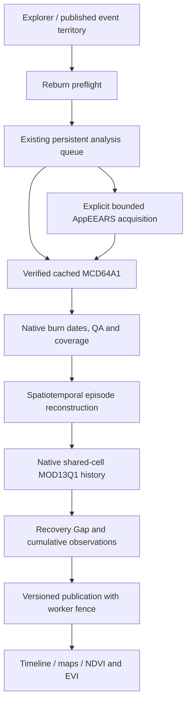

# Reburn Intelligence — Phase 6

AfterFire extends the existing event satellite pipeline. It does not replace FIRMS, AppEEARS, Recovery Story, Before/After, comparison or PostGIS. See [detection methodology](REBURN_DETECTION_METHODOLOGY.md), [Recovery Gap](RECOVERY_GAP.md), [cumulative vegetation](CUMULATIVE_VEGETATION.md), [performance](PERFORMANCE_OPTIMIZATION.md) and [verification](PHASE6_VERIFICATION.md).



## API

All routes are under `/api/v1`. Request example:

```json
{
  "source_job_id": "published-satellite-job-id",
  "parameters": {
    "start": "2021-01-01",
    "end": "2026-10-28",
    "separation_days": 32,
    "freshness_days": 48
  },
  "acquire_missing": false
}
```

`source_job_id` can be omitted to use the latest published source for the event. The request is limited to that source's observed/provisional analysis geometry. Generic AOI-only analysis without an existing event publication is not implemented; select a territory through Explorer and publish its satellite source first.

| Method / endpoint | Behaviour |
|---|---|
| POST `/events/{id}/reburn-analysis/preflight` | Bounded local metadata inventory, quota/free/protected/recoverable bytes; no NASA task submission or full raster scan |
| POST `/events/{id}/reburn-analysis` | 202, stable persistent job ID; defaults to cached-only analysis |
| GET `/events/{id}/reburn-analysis/status?job_id=…` | Durable state/telemetry; omitted job ID selects latest event request |
| GET `/events/{id}/reburn-analysis/stream?job_id=…` | Existing SSE pattern, reconnectable status snapshots and keepalives |
| GET `/events/{id}/reburn-analysis/result?job_id=…` | Typed scientific result; large cell histories/map are separate |
| GET `/events/{id}/reburn-history` | Episodes/provenance, limit ≤100 and offset |
| GET `/events/{id}/reburn-map` | Native observed cell features, limit ≤5000 and offset |
| GET `/events/{id}/reburn-cells/{cell}` | Actual cell burn dates, uncertainty, NDVI/EVI series and gap support |
| GET `/events/{id}/recovery-gap` | Shared-cell assessments; optional episode_a/episode_b |
| GET `/events/{id}/cumulative-vegetation` | Fixed-reference observations and segment summaries |
| GET `/reburn-sources` | Published real source territories, area_id filter, limit ≤100 and offset |

Every result supports `job_id` selection so older scientific versions remain inspectable. Unknown or cross-event identities are 404; absent source publication is 409; invalid dates/parameters are 422. Missing/corrupt sources create explicit failures and partial histories. No invented empty months or interpolated vegetation values are returned. Published result progress reaches 100 only in the atomic result transaction.

## Persistence and acquisition

`ReburnHistoryRecord` is one additive table linked to `EventAnalysisJob` and `EventAnalysisResult`. Episodes, cells, candidate associations, gap assessments and cumulative observations are versioned in its scientific payload rather than duplicate copies of the historical archive. The existing `init_db()` additive metadata creation registers the table; no FIRMS table is dropped or rebuilt.

Requests hash source publication, parameters, source inventory, algorithm and acquisition policy. Identical requests reuse the same job. A changed inventory may produce a new identity; this is intentional scientific input versioning. Failed requests can retry; completed/partial publications remain available by ID. Queue claiming, owner tokens, heartbeat, lease expiry and publication fencing are shared with earlier phases. `latest_job()` excludes reburn jobs when selecting the original satellite analysis.

`acquire_missing=true` explicitly enables geographically bounded annual AppEEARS MCD64A1 tasks for the requested period. Tasks and partial file manifests persist and resume after restart. Native HDFs are reused when verified; subset identity, manifest checksum, file SHA256, CRS and affine alignment are checked. Existing byte, granule, disk, block and area quotas apply. No global tile acquisition is introduced. Remote bundle size remains unknown until NASA publishes it, then disk capacity is checked before transfer. Preparing future deterministic tasks during the verification run transferred no scientific files and did not broaden the authorized AOI/interval.

Vegetation reuses the selected publication's native QA-screened rasters; Phase 6 does not silently enlarge that publication's vegetation interval or spatial support. Missing baseline/coverage therefore remains insufficient. Post-cutoff composites are excluded from newly computed trajectories while earlier baseline context is retained.

## UI

Explorer → Event Analysis → **Reburn History**, or `/recurrence` → published territory, or `/events/{eventId}/reburn`. Both entry points read the same persisted results. The former demonstration Recurrence page was replaced; navigation no longer defaults to a synthetic preset.

The panel remembers the selected job ID per event across refresh, including an older reused cached result, and restores its scientific parameters. It provides explicit cached/acquisition controls, preflight, durable live status, observed episode timeline, previous/next and pair selectors, common-area assessment, separate NDVI/EVI evidence and native-cell map. Layers show episode counts, last burn, nominal interval category, Recovery Gap and mapping coverage. Cell clicks show actual cell-specific dates and uncertainty and switch the chart to that cell's native vegetation children. Timeline/composite selection marks the chart without inventing a date observation. Scientific confidence/provenance and missing periods remain visible.

Raster histories are not downloaded en masse. Reburn is dynamically loaded from Event Analysis only after opening the panel. GeoJSON and vegetation observations are fetched separately; cell series load on selection. Esri imagery is geographic context, with variable acquisition dates unrelated to the scientific observation dates.

Limitations: no independent AOI drawing workflow, no automatic regeneration/deletion of published assets, no ecological or predictive risk model. Maps use observed gridded footprints and categorical interval legend, not claimed subpixel fire perimeters.


## API-first acquisition update (2026-10-30)

Normal Analyze now prefers persisted results and verified native sources/subsets, then configured compatible Collection 6.1 APIs. Missing data never triggers automatic full-tile HDF transfer or new AppEEARS submission. Scientific QA, baselines, anomalies, recovery and reburn calculations are unchanged. ORNL collection equivalence and live Earth Engine access remain explicit limitations. See [API-first engine](API_FIRST_SATELLITE_ENGINE.md), [provider equivalence](PROVIDER_EQUIVALENCE.md) and [verification](API_FIRST_VERIFICATION.md) for current behavior; older acquisition descriptions above are historical.
