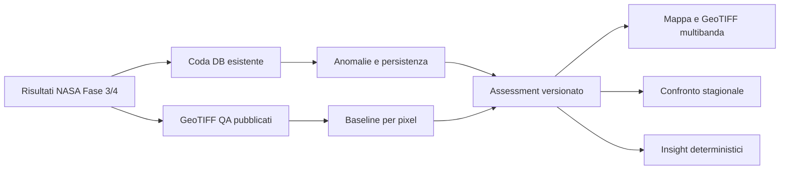

# Recovery Intelligence — Fase 5

Estensione della pagina evento e della sezione Compare esistenti. Nessuna nuova applicazione, nessun dataset fittizio, nessuna previsione AI. [Metodologia](RECOVERY_ASSESSMENT_METHODOLOGY.md), [spazio](SPATIAL_RECOVERY_ANALYSIS.md), [preflight](ASYNC_PREFLIGHT.md), [cache](CACHE_MANAGEMENT.md), [rapporto di verifica](PHASE5_VERIFICATION.md).

## Persistenza

`event_analysis_jobs` viene riutilizzata per planner e assessment, con identità distinte dalle analisi originali. `recovery_assessments` conserva sorgente, parametri, fingerprint/versione, evidenze aggregate e spaziali. `recovery_comparisons` memorizza confronti riproducibili fra 2–4 assessment. Non vengono riscritte le tabelle FIRMS, le osservazioni originali o i risultati precedenti.

L’identità dell’assessment comprende SHA-256 del payload sorgente, versione scientifica e parametri. Un retry della stessa sorgente/parametri riusa il risultato; una nuova pubblicazione della sorgente invalida il vecchio assessment per la consultazione corrente. Pubblicazione atomica e fencing impediscono a un worker con lease perso di sostituire il risultato. Gli asset derivati restano protetti. Le vecchie versioni restano tracciabili come pubblicazioni storiche.

## API

Tutti gli endpoint sono sotto `/api/v1` e compaiono nell’OpenAPI FastAPI.

| Operazione | Endpoint |
|---|---|
| Richiedi assessment locale | `POST /events/{id}/recovery-assessment` con `source_job_id` e `parameters` opzionali |
| Stato persistente | `GET /events/{id}/recovery-assessment/status?job_id=…` |
| SSE | `GET /events/{id}/recovery-assessment/stream?job_id=…` |
| Risultato aggregato | `GET /events/{id}/recovery-assessment/result?source_job_id=…` oppure `assessment_id` |
| Mappa data/indice | `GET /events/{id}/recovery-assessment/map?assessment_id=…&index=NDVI&observation_date=YYYY-MM-DD` |
| Serie di una cella | `GET /events/{id}/recovery-assessment/cells/{riga:colonna}?assessment_id=…&index=NDVI` |
| Insight con evidenze | `GET /events/{id}/recovery-assessment/insights?assessment_id=…` |
| GeoTIFF nativo | `GET /events/{id}/recovery-assessment/assets/{assessment_id}/{filename}` |
| Assessment selezionabili | `GET /recovery-assessments?limit=100&offset=0` |
| Confronto persistente | `POST /recovery-comparison` con `assessment_ids` e `index` |
| Riapri confronto | `GET /recovery-comparison/{id}` |

Il POST dell’assessment non acquisisce dati NASA: usa solo pubblicazioni esistenti. Se manca una pubblicazione risponde 409. Parametri invalidi e finestre fuori dal periodo sorgente vengono rifiutati. Nessun raster massivo viene serializzato come matrice JSON.

## Confronto

Ogni punto usa l’anomalia rispetto alla **propria** baseline pre-evento, allineata a `(data_composito − ultimo_rilevamento_FIRMS)/30,436875` mesi. Le curve mantengono null per le lacune; non vengono interpolate. Il periodo comune è l’intersezione fra prima e ultima osservazione supportata di ogni serie; se dura meno di tre mesi o una serie vi ha meno di tre punti supportati, l’esito è insufficient_data. Il grafico e gli indicatori delle schede (trend, persistenza, prima/ultima anomalia e supporto) sono ricalcolati sullo stesso orizzonte temporale comune, con la stessa scala per gli eventi. Non si contrappongono una pendenza quinquennale e una semestrale come se coprissero lo stesso periodo.

Si verificano prodotto/collezione, versione, parametri di baseline/QA, soglie assessment, supporto delle osservazioni e supporto geografico (celle bruciate vs buffer). Esiti: `comparable_with_limitations`, `caution`, `insufficient_data`. Meno di tre mesi di orizzonte comune, osservazioni insufficienti o versioni incompatibili impediscono un confronto conclusivo. Differenze nei parametri e nel supporto geografico producono cautela. Ogni evento mantiene la propria geometria; non viene costruito un ranking.

Non sono disponibili classificazioni ecologiche/land-cover validate per questi casi: non si presume che vegetazione, clima o uso del suolo siano equivalenti. Due anni o stagioni differenti sono supportati dall’allineamento e dalla baseline, senza pretendere che questo elimini ogni confondente.

## Interfaccia

La Recovery Story conserva il controllo di data e indice, condiviso con la mappa di anomalie. L’assessment espone una finestra post-evento opzionale, evidenze iniziali/ultime, trend, persistenza, copertura, discordanza NDVI/EVI, dettagli per cella ed esportazioni. Stato e progresso derivano dalla telemetria del worker, con SSE e polling di recupero. Nessuna ETA inventata.

Compare Recovery è accessibile dalla pagina evento e Compare. I selettori elencano soltanto assessment pubblicati reali, con ID nella URL per riprendere la selezione al reload. Le funzionalità di confronto legacy restano disponibili sotto il nuovo pannello.

## Phase 6 — Reburn & Recovery Gap

The existing implementation is extended by [Reburn Intelligence](REBURN_INTELLIGENCE.md), [observed episode methodology](REBURN_DETECTION_METHODOLOGY.md), [shared-area Recovery Gap](RECOVERY_GAP.md) and [cumulative vegetation](CUMULATIVE_VEGETATION.md). See [measured infrastructure changes](PERFORMANCE_OPTIMIZATION.md) and [verification and limitations](PHASE6_VERIFICATION.md). Previous-phase publications and reports are preserved.

## API-first acquisition update (2026-10-30)

Normal Analyze now prefers persisted results and verified native sources/subsets, then configured compatible Collection 6.1 APIs. Missing data never triggers automatic full-tile HDF transfer or new AppEEARS submission. Scientific QA, baselines, anomalies, recovery and reburn calculations are unchanged. ORNL collection equivalence and live Earth Engine access remain explicit limitations. See [API-first engine](API_FIRST_SATELLITE_ENGINE.md), [provider equivalence](PROVIDER_EQUIVALENCE.md) and [verification](API_FIRST_VERIFICATION.md) for current behavior; older acquisition descriptions above are historical.

## Phase 6.5

See [measured performance and verification](ULTRA_FAST_ANALYSIS.md),
[native batching](EARTH_ENGINE_BATCHING.md) and
[on-demand visualization](LAZY_RASTER_GENERATION.md). Scientific formulas and QA
thresholds are unchanged; native spatial consumers retain the original float32 contract.

## Release verification — 2026-11-06

See [the current release record](FINAL_RELEASE_VERIFICATION.md) for newly executed multi-continent FIRMS/Earth Engine checks, strict QA and baseline evidence, cold/warm/cache measurements, 189 tests on each database, frontend verification and explicit remaining limits. Earlier measurements in this document remain historical; they were not newly revalidated against deleted HDF sources.

## Final functional audit — 6 November 2026

The [requirements matrix](ORIGINAL_REQUIREMENTS_AUDIT.md), [independent current-data validation](POST_FIRE_RECOVERY_VALIDATION.md), [desktop/mobile checks](RECOVERY_UX_VERIFICATION.md) and [final report](FINAL_FUNCTIONAL_VERIFICATION.md) supersede earlier release-status claims. Scientific thresholds, source observations and previously published results remain unchanged. The current entry point is Explorer or `/recovery`, listing persisted event assessments. Cell selection now opens its native NDVI/EVI history, seasonal reference, anomalies and explicit missing dates. Compare uses seasonal event anomalies on the common observed post-fire horizon; legacy non-seasonal area quotient panels are excluded.
