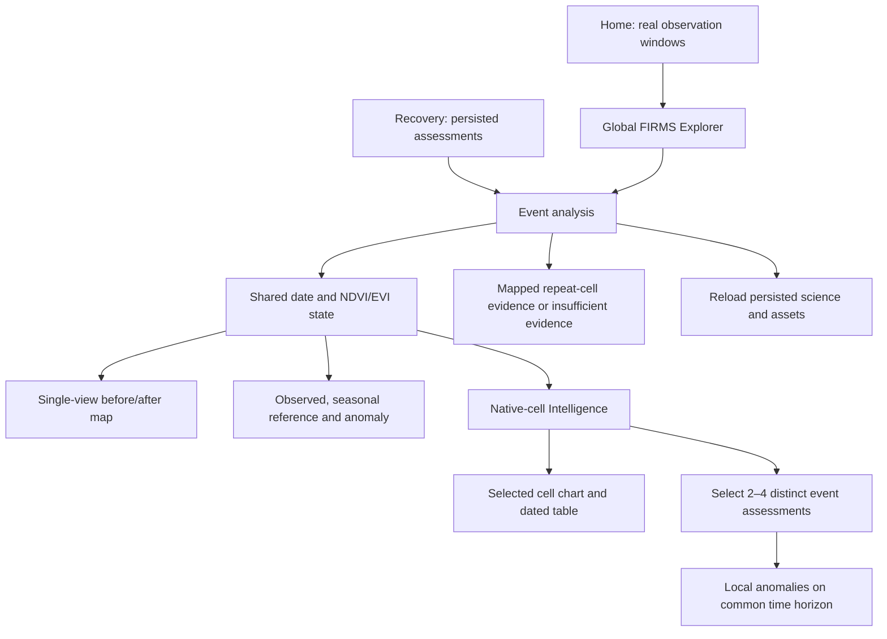

# Recovery UX verification — 6 November 2026

The test target is the real loopback `afterfire-clean` deployment, not intercepted API fixtures. Chromium uses the built React/Router 7 bundle served by Nginx and real persisted NASA event results. Desktop is 1440×1050; mobile is 390×844. Evidence and measurements are collected in [the final machine record](final-recovery-evidence-2026-11-06.json).

## Main user path

Home → bounded FIRMS Explorer → candidate selection → Event Analysis/preflight → saved or requested satellite publication → dated NDVI/EVI map/chart → split Before/After → Recovery Intelligence → native cell history → Reburn History → Compare Recovery → reload.

A new `/recovery` entry lists published assessments directly, so previously analyzed territories can be opened without knowing their IDs or editing files. Empty installations explain how to select an event and compute an assessment. Historical Home cards link to real bounded observation queries; no fixed impact or recovery metrics are displayed.

## Executed browser checks

`scripts/verify_release_browser.mjs` checks actual FIRMS candidates, shared Explorer dates/viewport, atomic source switching, stale-candidate removal for invalid dates, candidate navigation, the exact published Rhodes Story, cached result display, lazy raster loading, EVI switching, synchronized Before/After selectors, Intelligence and Reburn panel navigation. It tests runtime page errors and horizontal overflow on desktop and mobile. The exact published Rhodes ID is used because viewport membership changes candidate identity legitimately.

`scripts/verify_recovery_browser.mjs` adds both viewport sizes for Home → Recovery library, real published event links, selected native-cell chart, complete dated table, explicit gaps and reference support, comparison of Rhodes and Kangaroo Island with NDVI/EVI, persisted comparison URL and reload. A displayed cell-table row is checked against the dedicated real cell API. The old fixed 64% card and quotient comparison panel must be absent. No fake satellite values or request interception are used.

Native-cell selection displays row/column identity, WGS84 footprint centre (explicitly approximate), NASA product/strict QA provenance, value, baseline, anomaly, classification, completeness, persistence duration and native footprint area. History values remain per cell; the event median is never copied across the map.

## Scientific interpretation and accessibility

Story date selection, index and raster/chart context share the existing selected state. Split Before/After uses one Leaflet view, preserving centre and scale. Composites have explicit dates/periods and a fixed index legend; no extra interpolated satellite frames are generated. The basemap remains contemporary geographic context. The comparison reports differences of spatial medians, not common-pixel causal change.

NDVI/EVI explanations use native expandable controls usable by keyboard/touch. Observed value, seasonal baseline, anomaly, descriptive indicators, reference spread and insufficient observations are described separately. Cell history includes a table as an alternative to chart-only inspection. Compare checkboxes, index selector and existing date/range controls have accessible labels. Insufficient/nodata cells remain visually distinct from negative anomalies.

Visual screenshots are inspected for representative map, chart, table, comparison, navigation and mobile layout. Automated page errors/overflow checks are evidence for those scenarios only, not an exhaustive WCAG audit or every browser/device. No physical phone, screen reader, colour-vision study or full keyboard traversal of every Leaflet polygon is claimed. Native map-cell selection remains pointer/touch based; the selected cell's table is accessible after selection.

## Persistence and performance

Before/after service recreation compares canonical API hashes for all three science payloads, all three assessment results and the real Reburn publication. Repeated Analyze retains the same IDs and attempt counts. A reload reads persisted results without a new source acquisition. This first proved saved-result survival across container recreation. A later external host restart cleared host temporary files; all original result/assessment/Reburn hashes were rechecked against the durable pre-restart evidence and remained identical. The agent did not initiate that reboot, and no controlled in-flight power-loss experiment is claimed.

Browser saved-result and lazy-frame timings are reported separately from pipeline acquisition. Existing cached services and network conditions are part of the measurement; there is no new cold-cache or controlled A/B speedup claim.

## Additional positive Reburn scenario

`scripts/verify_positive_reburn_browser.mjs` verifies the newly published real Chips/Dixie history at both viewport sizes: 228 repeated native cells, the 226-cell shared episode pair, explicit `insufficient_observations` Recovery Gap, selected-cell burn dates in both 2012 and 2021, no page errors and no horizontal overflow. A second two-cell shared component is retained in the API. Four reconstructed components do not imply four official fires. The selected-cell screenshot and the native vegetation-history screenshot were visually inspected after the final run.
