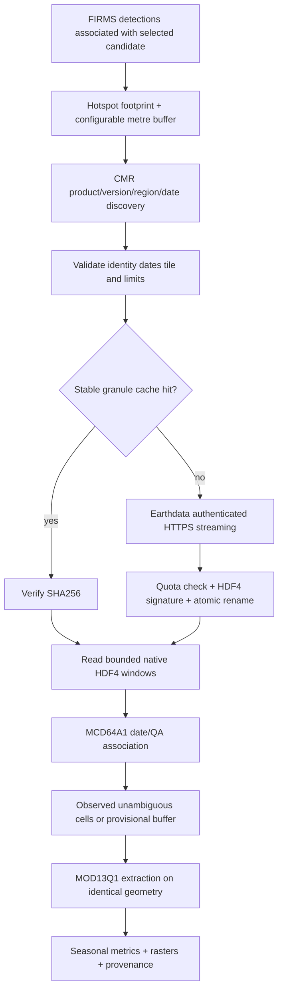
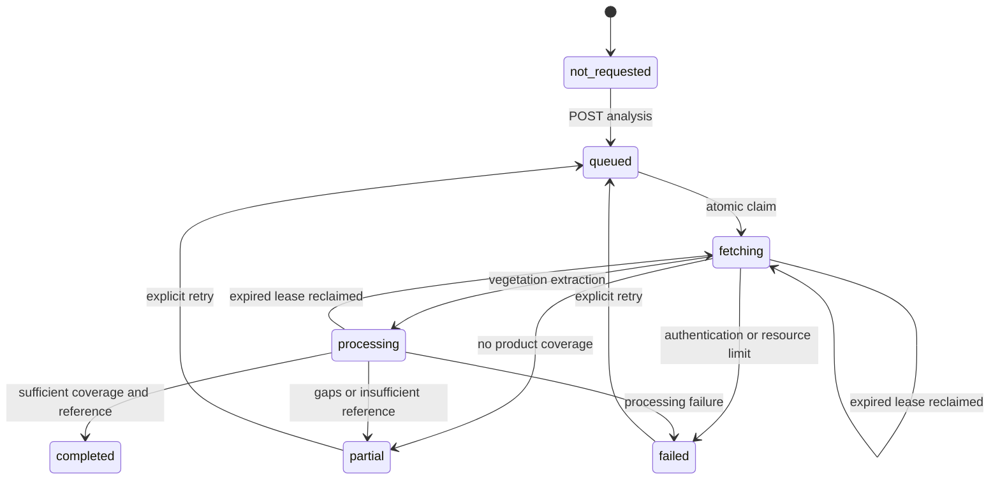

# NASA satellite data pipeline

## Supported official access

[NASA CMR Search API](https://cmr.earthdata.nasa.gov/search/site/docs/search/api.html) discovers HTTPS data links using product short name, collection `061`, event bounding box and time interval. The provider follows CMR pagination, validates granule filename/product/tile/date against metadata, selects the latest production revision for each product/tile/composite and rejects unsupported versions. No data-pool URL is manufactured. Discovery is public; acquisition requires Earthdata authentication and any applicable LP DAAC authorization/EULA.

[earthaccess](https://earthaccess.readthedocs.io/) supplies the authenticated HTTP session and redirect handling for username/password. Set `EARTHDATA_USERNAME` and `EARTHDATA_PASSWORD` in the backend environment (Docker Compose passes both). `EARTHDATA_TOKEN` is an alternative backend-only token. Never expose credentials to Vite. Provider errors in job records omit authenticated URLs and account details.

Products:

* [MCD64A1.061](https://lpdaac.usgs.gov/products/mcd64a1v061/): monthly burned area, nominal 500 m, Burn Date, Burn Date Uncertainty and QA SDS.
* [MOD13Q1.061](https://lpdaac.usgs.gov/products/mod13q1v061/): 16-day NDVI/EVI, nominal 250 m, detailed VI Quality and pixel reliability SDS.

Whole **intersecting MODIS tiles**, not global products, are downloaded and shared between events. The local reader extracts only the event window from HDF4 using pyhdf. A tile can be much larger than the event: resource limits intentionally reject overly large time windows. This implementation does not claim server-side area subsetting. [NASA AppEEARS](https://appeears.earthdatacloud.nasa.gov/) is an official subset alternative, but is not used by this provider.

The MODIS sinusoidal grid has sphere radius 6,371,007.181 m, tile width approximately 1,111,950.52 m, 4,800² MOD13Q1 cells and 2,400² MCD64A1 cells. Native grid cells are approximately 231.66/463.31 m wide; nominal 250/500 m are product labels. File identity includes product, date, tile, collection and production revision. Expected vegetation pixel count is computed over **all** intersecting native tiles, so an unavailable tile reduces valid coverage instead of silently shrinking the denominator.

## Durable worker

A unique SHA256 job ID covers event ID, validated configuration (including `as_of`) and algorithm version. PostgreSQL claims use `FOR UPDATE SKIP LOCKED` and a conditional update; SQLite uses a conditional update. A fenced owner token prevents an expired worker from publishing. Leases last three minutes, heartbeat every twenty seconds. API and worker schema initialization are serialized by a PostgreSQL transaction advisory lock. After a crash, cached files are reused and statistics recomputed; there is no requirement to retain in-memory progress.

`python -m app.jobs.analysis_worker` runs outside the API. Compose provides one dedicated worker service with a configurable number of lanes. Worker cancellation leaves an expiring lease. A successful publication replaces observations and result in one DB transaction; a failed retry retains the previous published result and its assets. Each attempt has unique asset filenames.

Granule absence, provider outages, invalid raster layers and QA rejection are surfaced in warnings or failure state. Partial results are legitimate missing-data reports, never scientific confirmation. A resource-limit failure stops the job with a clear message. No source granule is fabricated.

See [methodology](SCIENTIFIC_METHODOLOGY.md), [cache policy](ANALYSIS_CACHE.md), [user/API flow](POST_FIRE_RECOVERY.md).

## Phase 3 — verified pipeline and monitoring

The 2.1.0 pipeline verifies internal HDF identity, native grid and band calibration, then publishes worker-owned phase/file/byte telemetry over the existing status API and the new SSE stream. All-null observations with no burned cells fail explicitly. See [Phase 3 validation and reproduction](PHASE3_VALIDATION.md).

## Phase 4 acquisition

CMR full-granule sizes are now catalog metadata, not remote subset estimates. Verified cached HDFs precede native AppEEARS area extraction; the HDF fallback remains bounded. Annual task manifests, checksummed files and native vegetation checkpoints survive worker restarts. A completed interval aggregates all requested observations before seasonal baseline calculation. See [subsetting architecture and resource contracts](SATELLITE_SUBSETTING.md).

## Integrazione Fase 5 — Recovery Intelligence

La Fase 5 estende questa implementazione preservandone osservazioni e risultati. Il preflight ora restituisce 202 con una pianificazione persistente, non un piano sincrono. Si vedano [architettura/API](RECOVERY_INTELLIGENCE.md), [metodologia degli indicatori](RECOVERY_ASSESSMENT_METHODOLOGY.md), [analisi per pixel](SPATIAL_RECOVERY_ANALYSIS.md), [preflight asincrono](ASYNC_PREFLIGHT.md), [gestione cache](CACHE_MANAGEMENT.md) e [verifica Fase 5](PHASE5_VERIFICATION.md). Le descrizioni delle prove Fase 3/4 restano evidenze storiche, non misurazioni della nuova implementazione.

## Phase 6 — Reburn & Recovery Gap

The existing implementation is extended by [Reburn Intelligence](REBURN_INTELLIGENCE.md), [observed episode methodology](REBURN_DETECTION_METHODOLOGY.md), [shared-area Recovery Gap](RECOVERY_GAP.md) and [cumulative vegetation](CUMULATIVE_VEGETATION.md). See [measured infrastructure changes](PERFORMANCE_OPTIMIZATION.md) and [verification and limitations](PHASE6_VERIFICATION.md). Previous-phase publications and reports are preserved.

## Fast analysis update — 30 October 2026

Current acquisition policy supersedes earlier automatic AppEEARS instructions: retained HDF/native subset cache, read-only existing tasks, then bounded direct Earthdata HTTPS HDF. New task submission defaults to disabled. See [Direct NASA acquisition](DIRECT_NASA_ACQUISITION.md).

## API-first acquisition update (2026-10-30)

Normal Analyze now prefers persisted results and verified native sources/subsets, then configured compatible Collection 6.1 APIs. Missing data never triggers automatic full-tile HDF transfer or new AppEEARS submission. Scientific QA, baselines, anomalies, recovery and reburn calculations are unchanged. ORNL collection equivalence and live Earth Engine access remain explicit limitations. See [API-first engine](API_FIRST_SATELLITE_ENGINE.md), [provider equivalence](PROVIDER_EQUIVALENCE.md) and [verification](API_FIRST_VERIFICATION.md) for current behavior; older acquisition descriptions above are historical.
