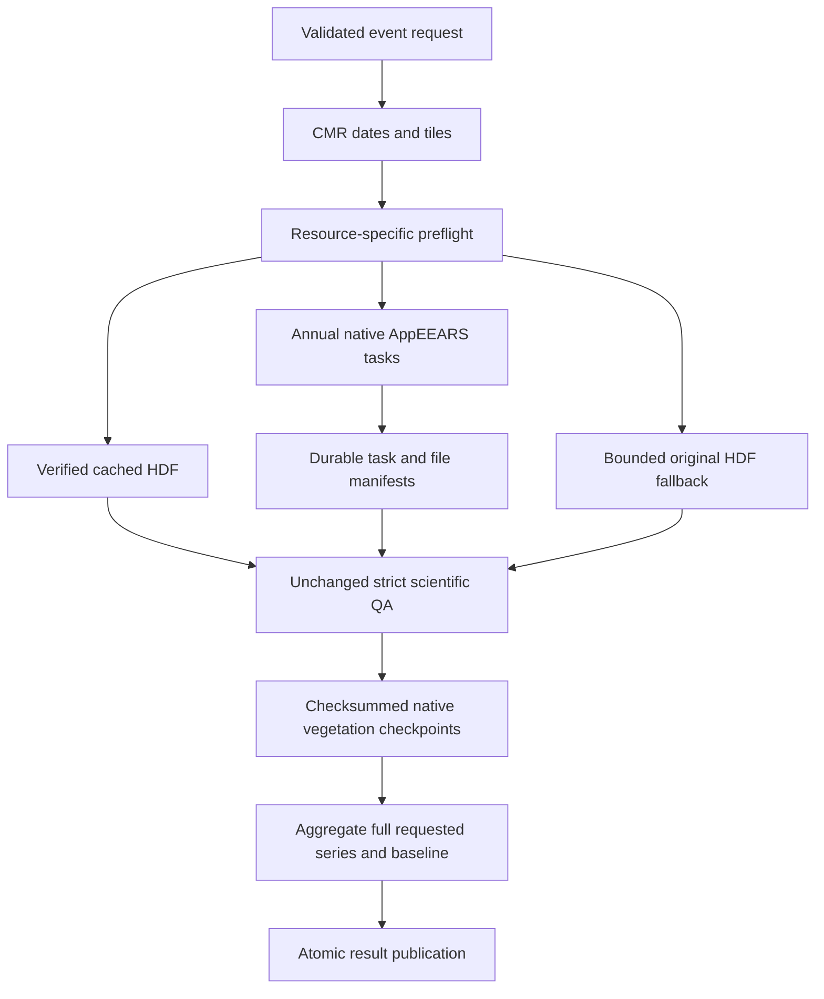

# Phase 4 acquisition audit (before implementation)

The original `run_pipeline` in `backend/app/services/post_fire_pipeline.py` rejects
`sum(record.expected_bytes) > AFTERFIRE_ANALYSIS_MAX_JOB_GB * 1024**3` before
checking any cached source. CMR `granule_size` is converted from MiB to bytes;
it describes complete HDF4 tiles, not remote extraction output. The configured
and default limit is 5 GiB. The subsequent `consumed_bytes` also includes cache
hits and is passed as the remaining network allowance. Thus a completely cached
multi-year request can fail without requiring one byte of network traffic.

`acquire` downloads the complete HDF, checks its signature and scientific
metadata, then `read_subset` reads a bounded local window. This saves processing
memory but no network traffic. No remote spatial subset provider or temporal
checkpoint exists in Phase 3. All requested years share one source-volume cap.
The separate existing cache quota is 10 GiB, minimum free disk is 1 GiB,
concurrent downloads default to 2 and granule count to 400. No limits are raised
as part of Phase 4.

The original HDF path remains available. AppEEARS requires its own login-issued
token; the direct-download Earthdata bearer is not assumed compatible.

Primary reference: [NASA AppEEARS API](https://appeears.earthdatacloud.nasa.gov/api/).

## Implemented acquisition path

Required layer names are resolved against the live `/product/{product}.061`
metadata. The checked API responses are retained in
`phase4-appeears-MOD13Q1.061.json` and `phase4-appeears-MCD64A1.061.json`.
Both products and all required layers were available on 28 October 2026:

- MOD13Q1: `_250m_16_days_NDVI`, `_250m_16_days_EVI`,
  `_250m_16_days_VI_Quality`, `_250m_16_days_pixel_reliability`.
- MCD64A1: `Burn_Date`, `Burn_Date_Uncertainty`, `QA`, `First_Day`, `Last_Day`.

AppEEARS login uses the backend Earthdata username/password to obtain a separate
short-lived token. The existing direct-download bearer is never repurposed.
Secrets and signed output URLs are not put in manifests, public errors or results.
The service may return an HTTP redirect for a file download; its NASA-provided
HTTPS S3/CloudFront destination is validated and fetched without login headers.

### Task and cache identity

Each native GeoTIFF area request is keyed by product/version, exact region,
annual date block, required layers, format, projection and adapter version. A
cross-process lock serializes task creation/download. The deterministic task
name also recovers the narrow crash window between NASA accepting POST and local
manifest publication. Saved task IDs are polled after a restart, not resubmitted.
All missing annual groups are submitted first so NASA processing can overlap;
file downloads and scientific processing remain bounded and serial per worker.

The extraction polygon is the existing scientific provisional AOI's native
sinusoidal envelope plus one 500 m cell margin, converted back to geographic
coordinates for NASA. This is deliberately larger than the final uniquely
associated burned-cell geometry: burned cells are not known before acquisition,
and their whole native extents must be available for later vegetation selection.
Statistics still use precisely the final analysis geometry and pixel centres.
Annual extraction can include composites outside the requested range; only CMR
records fully inside the requested scientific interval enter the time series.
No year is removed from the request, and no incomplete future composite is used.

Downloaded TIFFs have measured byte counts and SHA-256 checksums. A complete
verified local bundle can be reused even after NASA expires the online outputs.
Processed vegetation checkpoints are keyed by source revision, exact analysis
geometry and engine version, contain both QA-screened native indices, and are
checksummed before reuse. Extending the requested end date reuses older complete
years and native processed windows; aggregate seasonal baselines are recomputed
from the complete set of pre-event observations. A changed partial final-year
request may need a new extraction task; no spatial-superset cache search is
attempted for differently shaped overlapping regions.

### Native scientific adapter and equivalence

Only native sinusoidal grids are accepted. Pixel size, zero rotation, integral
native-grid offset, band-to-band shape/affine agreement and integer QA/burn
classes are checked. Shifted grids fail instead of being silently reprojected.
Float VI output is already calibrated by AppEEARS. It is restored to the original
integer quantization (rounding error ≤0.002 raw units) before applying the exact
existing QA and scaling functions. Fill remains invalid. No class interpolation
is performed. Integer VI output must retain the original int16 representation.

The original HDF provider was retained until real independent-source equivalence
passed. Evidence in `phase4-equivalence.json` compares three VI composites and
one burned-area month: selected native pixel coordinates, each required band,
QA masks and VI statistics agree exactly. GeoTIFF window envelopes can omit
empty boundary rows included by floating-point floor/ceil in the HDF reader;
the comparison therefore indexes actual selected native cells. Per-cell area
allows 1e-9 km² tolerance for floating-point pixel-size metadata; this is not a
resampling tolerance. The runtime grid checks remain mandatory.

### Resource budgets

No original default was increased. `AFTERFIRE_ANALYSIS_MAX_JOB_GB=5` now means
**actual newly transferred scientific file bytes**, not complete tile volume or
cached source volume. Failed transfer blocks still count in streaming telemetry
and consume the current attempt's allowance. `MAX_BLOCK_GB=1` bounds a new HDF
file or the missing files in a remote annual block; concurrent downloads remain
2. `TEMP_MAX_GB=1`, `RESULTS_MAX_GB=2`, cache quota 10 GiB and free-disk reserve
1 GiB are separate controls. Derived results also count towards the global cache
quota. Quotas are checked during writes under the existing global quota lock.

The preflight reports CMR full-tile bytes separately. Remote output size is null
until NASA publishes its bundle; no area-ratio estimate is presented as fact.
Known new HDF bytes must fit the request budget. Provider failure may use the
original downloader only within the configured resource guards; otherwise the
job explains the limiting resource and preserves completed blocks. No bulk
fallback ignores the budget. Interrupted temporary downloads are removed;
completed sources/checkpoints/results remain. Existing opt-in HDF LRU policy is
unchanged and never removes FIRMS records or active-job assets. There is no
automatic removal of complete subset or result files in this phase.

## Integrazione Fase 5 — Recovery Intelligence

La Fase 5 estende questa implementazione preservandone osservazioni e risultati. Il preflight ora restituisce 202 con una pianificazione persistente, non un piano sincrono. Si vedano [architettura/API](RECOVERY_INTELLIGENCE.md), [metodologia degli indicatori](RECOVERY_ASSESSMENT_METHODOLOGY.md), [analisi per pixel](SPATIAL_RECOVERY_ANALYSIS.md), [preflight asincrono](ASYNC_PREFLIGHT.md), [gestione cache](CACHE_MANAGEMENT.md) e [verifica Fase 5](PHASE5_VERIFICATION.md). Le descrizioni delle prove Fase 3/4 restano evidenze storiche, non misurazioni della nuova implementazione.
