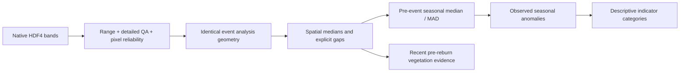

# AfterFire — Scientific Methodology & Algorithms

## 1. Challenge Context: Harmonization of MODIS and VIIRS Hot Spots

### 1.1 Sensor Footprints & Radiant Disparity
- **MODIS** (onboard Terra and Aqua): 1 km nominal nadir resolution with pixel broadening toward swath edges. High radiometric saturation limit on Channel 21/22 (4 µm) with Channel 31 (11 µm) for false alarm rejection.
- **VIIRS** (onboard Suomi-NPP, NOAA-20, NOAA-21): 375 m nominal nadir resolution on I-band (I4 at 3.74 µm, I5 at 11.45 µm).
- **Core Dilemma**: Because of the ~3-fold spatial resolution advantage, VIIRS detects smaller, lower-intensity, and smoldering fires that do not trigger the MODIS sub-pixel threshold. Directly summing detection points from both sensors over a single fire will grossly overestimate physical fire occurrences.
- **AfterFire Harmonization Rule**:
  1. Each raw record preserves instrument identifier, satellite, original confidence code, brightness temperature, and Fire Radiative Power (MW).
  2. Detections are categorized into standardized confidence tiers:
     - Numeric $\ge 80\%$ or categorical `'high'` $\rightarrow$ `high`
     - Numeric $30\% - 79\%$ or categorical `'nominal'` $\rightarrow$ `nominal`
     - Numeric $< 30\%$ or categorical `'low'` $\rightarrow$ `low`
  3. Daily, weekly, and monthly calendars group detections with discrete sensor breakout counts (`modis_count`, `viirs_count`) rather than unified scalar addition.
  4. Spatiotemporal clustering (greedy proximity rule: 7 km radius, 3-day gap, last 15 cluster observations; minimum 3 points) groups detections into candidate fire events without asserting official administrative perimeters.

  ### 1.2 Visual map clusters and candidate event identity

  The Explorer queries only observations within its current WGS84 map viewport and
  selected acquisition-date interval. MODIS and VIIRS can be queried independently.
  Visual marker clusters are screen-space groups that change with map zoom; they are
  not scientific fire events. Selecting a visual group zooms to its contents and only
  offers an event-analysis link when backend candidate membership identifies one or
  more algorithmic candidates.

  Candidate IDs are SHA-256-derived from the study-area ID and the sorted source
  detection IDs. They remain the same for the same unchanged set of detections,
  independent of input ordering. Candidate membership is stored separately from
  source observations so a shareable event URL can load its details directly. New
  observations can change cluster membership and therefore produce a new candidate ID.
  If the viewport result exceeds the API cap, the backend does not infer events from a
  partial subset; the user is asked to zoom in.

---

## 2. Differentiating Active Hotspots from MCD64A1 Burned Area

- **Point Hotspots**: Indicate thermal radiation emitted at the exact instant of satellite overpass (~4 passes daily per sensor). A single fire flaming over 5 days may generate 50+ detection records across overlapping passes.
- **MCD64A1 Burned Area Product**: Global 500m monthly composite providing pixel-level classification of charred land surface. Each classified pixel carries an estimated burn date (DOY) and temporal uncertainty (typically $\pm 2$ days).
- **AfterFire Separation**: The platform renders MCD64A1 as spatial polygon patches and displays total mapped hectares independently from hotspot detection totals.

---

## 3. Post-Fire Canopy Recovery Trajectory Engine

### 3.1 Pre-Fire Multi-Year Baseline
The implemented baseline is the mean and standard deviation of valid pre-fire
NDVI observations. It does not perform seasonal matching: phenology, sampling
imbalance and drought can affect the comparison. At least three valid pre-fire
and two valid post-fire observations are required; missing values never receive
a fabricated baseline or trough. The mean ± one standard deviation is a
sample-spread envelope, not a statistical confidence interval.

### 3.2 Disturbance Drop & Recovery Percentage
- **Fire Trough ($\text{NDVI}_{\text{trough}}$)**: Minimum valid composite value observed immediately post-disturbance.
- **Drop Magnitude**: $\Delta_{\text{drop}} = \mu_{\text{pre}} - \text{NDVI}_{\text{trough}}$
- **Drop Percentage**: $\%_{\text{drop}} = \left(\frac{\Delta_{\text{drop}}}{\mu_{\text{pre}}}\right) \times 100$
- **Recovery Quotient**:
  $$\text{Recovery \%} = \frac{\text{NDVI}_{\text{latest}} - \text{NDVI}_{\text{trough}}}{\mu_{\text{pre}} - \text{NDVI}_{\text{trough}}} \times 100$$

### 3.3 Status Classification
- **Substantially Recovered**: $\text{Recovery \%} \ge 90\%$
- **Partial Recovery**: $60\% \le \text{Recovery \%} < 90\%$
- **Stagnant / Slow Recovery**: $\text{Recovery \%} < 60\%$

---

## 4. Quality Assurance (QA) Bitmask Masking

MOD13Q1 provides a 16-bit QA word per composite. AfterFire inspects:
- **Bits 0–1 (MODLAND QA)**:
  - `00`: Ideal quality.
  - `01`: Acceptable quality.
  - `10` or `11`: Excluded due to cloud cover, aerosol, or unfilled values.
- **Bit 14**: Snow/Ice flag. Observations with this flag set are excluded from vegetative calculations.

---

## 5. Ecological Limitations

1. **NDVI Represents Greenness, Not Full Biodiversity**: Opportunistic pyrophytic weeds and early-successional shrubs produce high chlorophyll reflectance rapidly, masking lingering devastation in mature tree canopies and soil seed banks.
2. **Sub-Pixel Heterogeneity**: A 250m composite pixel averages 6.25 hectares; small unburned islands or severely scorched soil patches are integrated into a single spatial average.
3. **Compound Re-Burns**: Successive fires occurring before vegetation re-attains reproductive maturity can trigger irreversible ecological regime shifts from mature woodland to degraded pyrophytic scrub.

## Phase 2: event-scoped real MODIS engine (`modis-recovery-2.0.0`)

This section defines the **event analysis page's new engine**. Earlier area-level legacy recovery percentages are not used on this page. The new engine never reports a recovery percentage or `fully recovered`.

### Three distinct geometries

1. **Hotspot footprint**: convex extent of linked FIRMS coordinates (possibly a point/line), not a fire boundary. Actual linked dates define the observed event interval.
2. **Observed burned cells**: MCD64A1.061 native cells with centres inside the provisional territory, valid QA and a compatible burn-date uncertainty interval. Whole cells are retained. This is satellite-classified grid area, not a high-precision or official perimeter.
3. **Analysis area**: union of uniquely associated observed burned cells. If there are none, use the hotspot footprint buffered in a local azimuthal-equidistant metre CRS (default 1,000 m), explicitly labelled `provisional_hotspot_buffer`. NDVI/EVI across all dates use this **same** geometry.

MCD64A1 association uses `[burn_date − uncertainty, burn_date + uncertainty]` overlapping `[first_hotspot − tolerance, last_hotspot + tolerance]`, default tolerance 3 days. Burn date must be a valid day of the granule year, positive, land/valid QA bits 0 and 1 set, shortened mapping bit 2 clear, uncertainty 0–100 days. Contextual relabelling bit 3 is retained and recorded. Adjacent months around the observed interval are searched to allow temporal uncertainty; dates themselves determine association. No whole month's burned area is assigned wholesale.

All other non-demo candidates with linked detections in the buffered geographic search extent and overlapping temporal scope are tested using their metre-buffered nearby hotspots. A cell intersecting another temporally compatible candidate is `ambiguous`; competitor IDs are retained, and that cell is excluded from analysis-area selection. This is conservative candidate matching, not proof of causation. Monthly duplicate cell/date observations are deduplicated. A valid product with zero associated cells is distinguished from unavailable granules and insufficient mapping QA.

Cell area is `abs(pixel_width × pixel_height) / 10^6` km² in the native equal-area MODIS sinusoidal CRS, not the nominal 500 × 500 m approximation. Whole-cell areas can include land beyond the hotspot buffer. Native grid resolution, mixed pixels, subpixel fires, composite timing, persistent industrial heat sources and clustering errors limit interpretation.

### Vegetation extraction and quality

MOD13Q1.061 NDVI/EVI use `index = raw_integer × 0.0001`, raw valid range −2,000…10,000 inclusive. Values outside this range are missing, never clamped to plausible observations. The strict mask requires pixel reliability 0, MODLAND quality bits 0–1 = 0, usefulness bits 2–5 ≤ 2, aerosol bits 6–7 != 3, adjacent cloud bit 8 clear, mixed cloud bit 10 clear, land/water bits 11–13 = 1, snow bit 14 and shadow bit 15 clear. Missing QA is not accepted by this engine.

For each composite and index, compute the median and population spatial standard deviation of retained cell-centre pixels, valid count, expected count and valid fraction. Expected count covers all intersecting native tiles, including missing granules. The composite median is published only when valid fraction ≥ 0.5 (configurable). The `spatial_std` is spatial dispersion, **not** an uncertainty/confidence interval of the median. Pixel masks may differ across dates, so the fixed area does not imply exactly identical valid pixel samples.

Every expected MODIS 16-day composite in the configured window has an entry; unavailable or rejected observations have `value=null`. No imputation or synthetic intermediate frames. Composite starts follow day-of-year 1,17,…,353; the last period stops at year-end. Composite dates denote a **period**, not the exact acquisition date of every contributing pixel. A composite overlapping the first hotspot is not pre-event.

### Seasonal baseline and descriptive status

Default window: up to three previous years, then at most ten years after the last linked hotspot, clipped at the requested `as_of` date. Actual product availability may be shorter. These are operational defaults, not universally optimal scientific windows.

For target composite `t`, references `R(t)` are valid composites wholly before the event and within ±24 calendar days of the target season. Circular distance uses a leap-stable 366-day reference year to handle December/January. References are restricted to the requested historical window. At least three composites from at least two distinct years are required. Pre-event chart points additionally use only earlier composites to avoid reference leakage. Post-event values never enter the pre-event baseline.

* Seasonal baseline: `B(t) = median{x(r): r ∈ R(t)}` (dimensionless).
* Baseline variability: `MAD(t) = median{|x(r) − B(t)|: r ∈ R(t)}`.
* Descriptive band: `b(t) = max(0.05, 1.4826 × MAD(t))`.
* Seasonal anomaly: `A(t) = x(t) − B(t)`.
* Pre-event descriptive summary: median of all valid wholly pre-event composites; this is explicitly distinct from the seasonal baseline.
* Post-event summary: latest valid post-event composite and its actual period/date, with its seasonal anomaly.

Status: `above baseline` if `A>b`; `near baseline` if `−b≤A≤b`; `approaching baseline` if `−2b≤A<−b`; otherwise `below seasonal baseline`. Missing index or insufficient seasonal reference gives `insufficient data`. The 0.05 floor is a conservative operational minimum band width to avoid dividing/classifying around zero dispersion; these thresholds are documented **descriptive conventions, not validated ecological recovery thresholds**. “Approaching” describes a distance band, not proof of a positive temporal trend. No normalized percentage, rate or return-time is inferred from inadequate data. Near-baseline vegetation indices do not demonstrate restoration of species composition, canopy structure, soil function or ecological recovery.

### Later candidates and reburn gap

Later candidates must start after the selected event's last detection and have a metre-buffered hotspot footprint intersecting the analysis area. The search is confined to the configured post-event window and non-demo linked detections. They remain candidate activity, not official confirmed repeat fires.

`gap_start_days = later.start − first.start`; `gap_since_end_days = later.start − first.end`. Both are calendar days. Vegetation evidence before the later candidate uses the latest valid **NDVI composite wholly between the two events**, ending fewer than or equal to 48 days before the later start, on this result's geometry and original seasonal reference. Without such an observation, status is insufficient data. Historical uncertainty, quality/coverage, candidate geography and intervening disturbances remain explicit. Observations following a later candidate are not attributed exclusively to the first fire.

Primary specifications: [MOD13 C6.1 User Guide](https://hodari.ece.arizona.edu/documents/MODIS/MODIS_VI_UsersGuide_09_18_2019_C61.pdf), [MCD64 C6.1 User Guide](https://lpdaac.usgs.gov/documents/1006/MCD64_User_Guide_V61.pdf), [CMR Search API](https://cmr.earthdata.nasa.gov/search/site/docs/search/api.html). See [pipeline](SATELLITE_DATA_PIPELINE.md), [cache](ANALYSIS_CACHE.md), [user flow](POST_FIRE_RECOVERY.md).

A MOD13Q1 composite ending after the requested observation cutoff is not acquired or used as a measurement; its expected slot remains missing with `incomplete_period`. `as_of` bounds observation periods, **not** a reconstruction of which processing revision was published on a historical date: CMR is queried against its current holdings, and production revision is recorded explicitly.

## Phase 3 — verified pipeline and monitoring

Engine `modis-recovery-2.1.0` retains the strict event-scoped masks and seasonal formulas above, with explicit native HDF identity/georeferencing/calibration checks. NASA HDF NDVI/EVI scale_factor=10000 denotes the divisor; applied values remain raw × 0.0001. Independent real-raster verification confirmed 44 valid observations per index and 94 observed burned cells. See [formulas, QA and numerical evidence](PHASE3_VALIDATION.md).

## Phase 4 native subset equivalence

AppEEARS output must preserve the native MODIS sinusoidal grid, cell size, integer QA and burn-date classes. Already-scaled float VI output is restored to its source integer quantization before the unchanged strict QA and ×0.0001 conversion. Statistics select the same native pixel centres inside the same analysis geometry. Actual independent HDF/subset evidence and the explicitly motivated tolerances are in [subsetting](SATELLITE_SUBSETTING.md) and [verification](PHASE4_VERIFICATION.md). Before/After reports a difference of spatial medians; it does not claim a common-pixel change map or full ecological recovery. No scientific temporal interpolation is introduced.

## Integrazione Fase 5 — Recovery Intelligence

La Fase 5 estende questa implementazione preservandone osservazioni e risultati. Il preflight ora restituisce 202 con una pianificazione persistente, non un piano sincrono. Si vedano [architettura/API](RECOVERY_INTELLIGENCE.md), [metodologia degli indicatori](RECOVERY_ASSESSMENT_METHODOLOGY.md), [analisi per pixel](SPATIAL_RECOVERY_ANALYSIS.md), [preflight asincrono](ASYNC_PREFLIGHT.md), [gestione cache](CACHE_MANAGEMENT.md) e [verifica Fase 5](PHASE5_VERIFICATION.md). Le descrizioni delle prove Fase 3/4 restano evidenze storiche, non misurazioni della nuova implementazione.

## Phase 6 — Reburn & Recovery Gap

The existing implementation is extended by [Reburn Intelligence](REBURN_INTELLIGENCE.md), [observed episode methodology](REBURN_DETECTION_METHODOLOGY.md), [shared-area Recovery Gap](RECOVERY_GAP.md) and [cumulative vegetation](CUMULATIVE_VEGETATION.md). See [measured infrastructure changes](PERFORMANCE_OPTIMIZATION.md) and [verification and limitations](PHASE6_VERIFICATION.md). Previous-phase publications and reports are preserved.

## Fast analysis update — 30 October 2026

The fast-analysis changes preserve native cells, strict QA, scale factors, reliability, fill, seasonal baseline and burn-date/uncertainty rules. Actual native HDF/subset equivalence and offline replay evidence are in [verification](ANALYSIS_PERFORMANCE_VERIFICATION.md).

## API-first acquisition update (2026-10-30)

Normal Analyze now prefers persisted results and verified native sources/subsets, then configured compatible Collection 6.1 APIs. Missing data never triggers automatic full-tile HDF transfer or new AppEEARS submission. Scientific QA, baselines, anomalies, recovery and reburn calculations are unchanged. ORNL collection equivalence and live Earth Engine access remain explicit limitations. See [API-first engine](API_FIRST_SATELLITE_ENGINE.md), [provider equivalence](PROVIDER_EQUIVALENCE.md) and [verification](API_FIRST_VERIFICATION.md) for current behavior; older acquisition descriptions above are historical.

## Phase 6.5

See [measured performance and verification](ULTRA_FAST_ANALYSIS.md),
[native batching](EARTH_ENGINE_BATCHING.md) and
[on-demand visualization](LAZY_RASTER_GENERATION.md). Scientific formulas and QA
thresholds are unchanged; native spatial consumers retain the original float32 contract.
