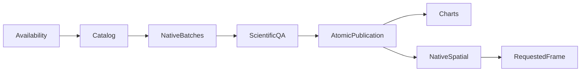

# Phase 6.5 — measured investigation

Remote checkpoint: `13a07428ba4338bf984ec10a309cfc04cc2cb258`.

Before changing algorithms, a cProfile replay of the latest retained reference
publication was run without catalog access or scientific publication. The replay
uses real retained NASA data, verified checkpoints and a separate output job.
Its 332 expected observations, metrics and 94 burned cells match the saved result
exactly. This is an offline replay, not a cold Earth Engine benchmark.

| Stage | Count | Wall time (s) | CPU time | Bytes | Optimization candidate |
| --- | ---: | ---: | --- | --- | --- |
| Complete reference replay | 1 | 71.706 | not isolated | 0 network | Separate cold integrity from warm science |
| Planning and source integrity | 1 | 65.116 | not isolated | retained HDF hashing | Reuse generation-bound validation evidence |
| Native source validation (cProfile cumulative) | 54 | 31.689 | not isolated | local reads | Avoid unnecessary HDF attribute decoding |
| Hashing (cProfile cumulative) | 1432 | 30.313 | not isolated | local reads | Preserve existing integrity evidence |
| Reused NDVI/EVI map assets | 330 | 2.606 | not isolated | 0 network | Defer visualization work |
| Seasonal baseline | 1 | 0.517 | not isolated | local arrays | Keep validated formulas |

Cumulative profile times overlap; they must not be added to stage wall times.
The earlier recent-event cold measurement remains 294.41 s, including 148.0874 s
acquisition/cache publication, 7.1818 s validation and 132.8966 s local processing.
These historical stage records do not isolate CPU or wire bytes. New measurements
must label decoded payload bytes separately from HTTP traffic.

Evidence: [before replay](phase65-before-replay.json),
[previous live verification](EARTH_ENGINE_LIVE_VERIFICATION.md).

## Measured follow-up

- [Batching and exact raw comparison](EARTH_ENGINE_BATCHING.md): 102 → 6 RPCs on
  51 reference sources; all raw bands identical. This includes native-grid checks.
- [Lazy asset contract](LAZY_RASTER_GENERATION.md): charts and native spatial data
  publish before rendering. No published map or original result was deleted.
- [Cold historical trial](phase65-cold-multiband.json): **22.8413 s**, **8.7484 s CPU**,
  72 real CMR/EE sources, 8 RPCs, 3246600 decoded bytes, 94 burned cells and
  **20.1779152898568 km²**. Two pre-fire years and one post-fire year; 63 valid NDVI
  and 63 valid EVI composites. Both indices have 21 wholly post-fire observations.
  No PNGs existed at first result. This isolated trial excludes DB publication,
  browser rendering and worker scheduling. Peak RSS 188420 KiB.
- The initial optimized cold trial before multiband storage took **46.9803 s**
  ([evidence](phase65-cold.json)). Its metrics/cells match the multiband trial.
- [Real persistent worker trial](phase65-live-worker.json): a different historical
  Italian candidate, 72 sources, 8 RPCs, 442912 decoded bytes, **57.47 s** pipeline
  time, 42 pre-fire and 20 post-fire observations per index. MCD64A1 mapped the AOI
  but found no associated burned cells: this is not an official fire perimeter.
  Existing leases, heartbeats, SSE and atomic publication were used. Repeat Analyze
  reused the same job/attempt. This trial preceded the final batch quota-reservation
  optimization and exposes pressure from the existing scientific-cache inventory.
- [Desktop/mobile browser](phase65-browser.json): saved result visible in **1.655 s**,
  requested dated raster loaded in **0.301 s**, no JS errors or horizontal overflow.
- [Recent event](phase65-recent.json): regional metadata identifies absent post-fire
  vegetation and event-month burn mapping; no scientific job or multiyear acquisition
  starts. Pre-fire context is available only by explicit request. Existing saved
  configurations bypass availability/provider work and retain their identity.

The supplied original HTTP publication SHA-256 is verified unchanged:
`351b026453f1912204b29822bba6d1fed0c4ac1628432c7701a135563edb7d00`.
It contains 166 expected NDVI and 166 expected EVI entries (154 valid per index),
94 burned cells. Its canonical sorted-JSON hash is a different representation:
`4c8c61e3c1a1227882fd6197ba0e54b537b6116123394b6ed251a8352d35597f`.
The offline full-series replay matches every observation, metric and burned cell.
The 71.706 → 7.312 s replay comparison includes freshly populated integrity evidence;
it is not an isolated measure of algorithm speed or a cold-acquisition claim.

SQLite and isolated PostgreSQL/PostGIS regressions: **181 tests each** before the
final quota-only adjustment; frontend TypeScript/Vite build passes. The scientific
fixture assertions remain unchanged; the asset assertion now also exercises lazy
materialization. No new AppEEARS tasks or automatic full-HDF downloads occurred.

The isolated 15–30 s target and cached <2 s target were observed. The persistent
worker trial missed 30 s. A p95 below 60 s is **not established** by these single
trials. CPU is measured per cache IO stage with `thread_time`; wall time uses
`perf_counter`. Stage/call/CPU metrics are retained in worker telemetry. Wire bytes,
SQL execution plans, standard-vs-high-volume comparisons, controlled 2/4/8 request
concurrency and remote-statistics equivalence remain unverified; none is claimed.

Deployment used a source-only layer over the existing verified backend image
`2306c2c35c72359b3d6210f0139072d68b2b1d43ee7a31bf91eabb391dd54beb`.
No dependency upgrade was deployed. The normal dependency-resolving build was stopped.
ADC remains mounted read-only only in server services; frontend receives no ADC.

## Clean installation measurement — 2026-11-06

A new Rhodes FIRMS candidate (30 observations; 2023-07-21–22) was analyzed over 2021–2024. Pipeline: **33.22 s**, request-to-result: **41.331 s**, 71 sources, **1,991,732 decoded bytes**, maximum cumulative explicit operation counter 8. Repeated Analyze returned the same job and attempt in **0.03174 s**. MOD13Q1 supplied both indices and strict QA; 134 MCD64A1 cells represent **28.76426222171076 km²**, not an official perimeter. The result is partial because rejected/missing composites remain gaps. QA/formulas were unchanged. A dated scientific map was materialized lazily and loaded in the browser.

This trial misses 15–30 s. It is not a controlled comparison with the former 294.41 s event, and does not establish p95<60 s. Wire bytes were not measured. See [measurement](clean-api-first-analysis.json). Previous archive/reference checks are unavailable on this intentionally empty installation; the 186 SQLite and 186 PostgreSQL regressions include controlled scientific fixtures, not new NASA/HDF equivalence proof.

## Release verification — 2026-11-06

See [the current release record](FINAL_RELEASE_VERIFICATION.md) for newly executed multi-continent FIRMS/Earth Engine checks, strict QA and baseline evidence, cold/warm/cache measurements, 189 tests on each database, frontend verification and explicit remaining limits. Earlier measurements in this document remain historical; they were not newly revalidated against deleted HDF sources.
